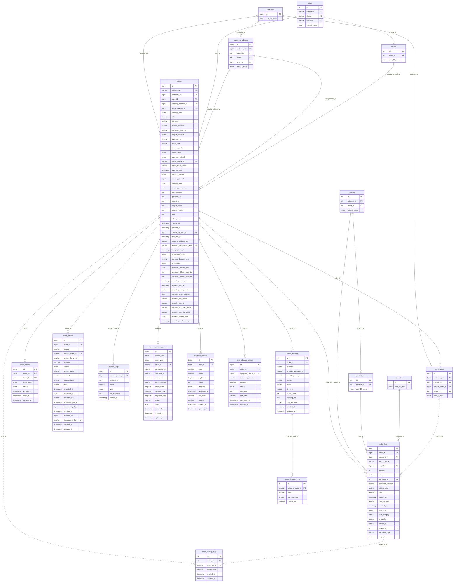
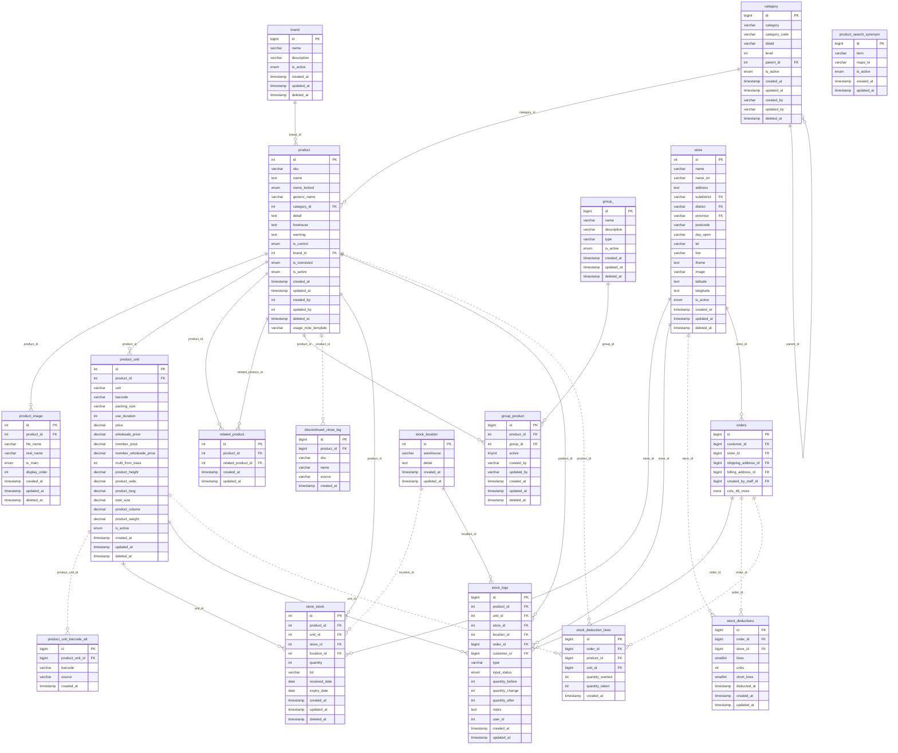
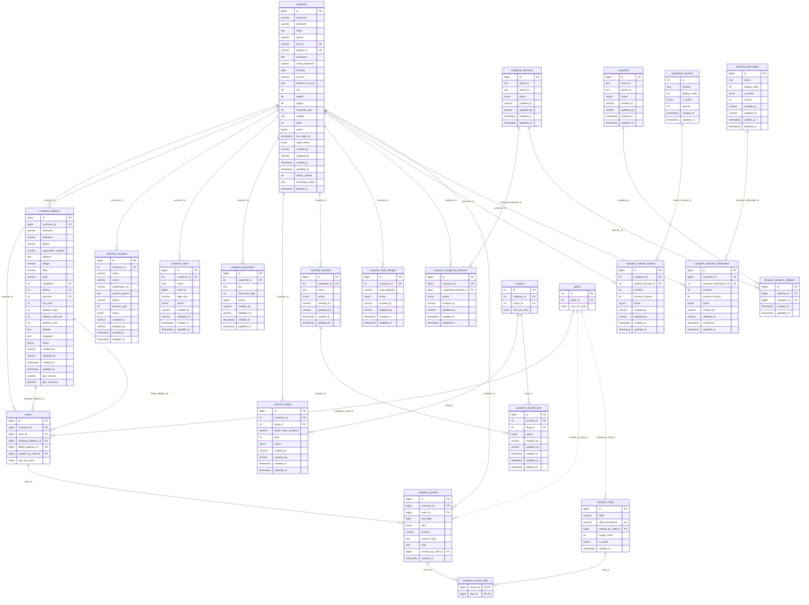
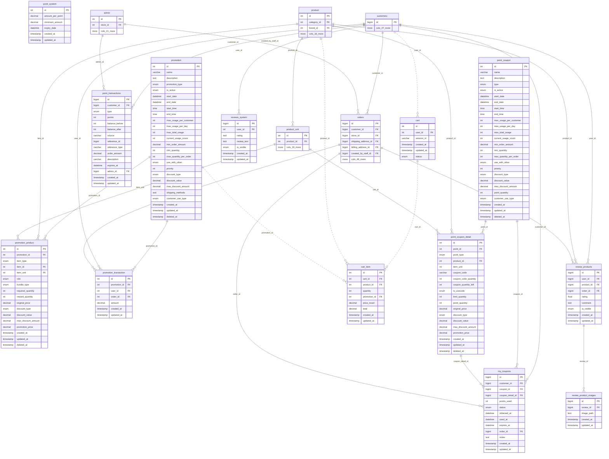
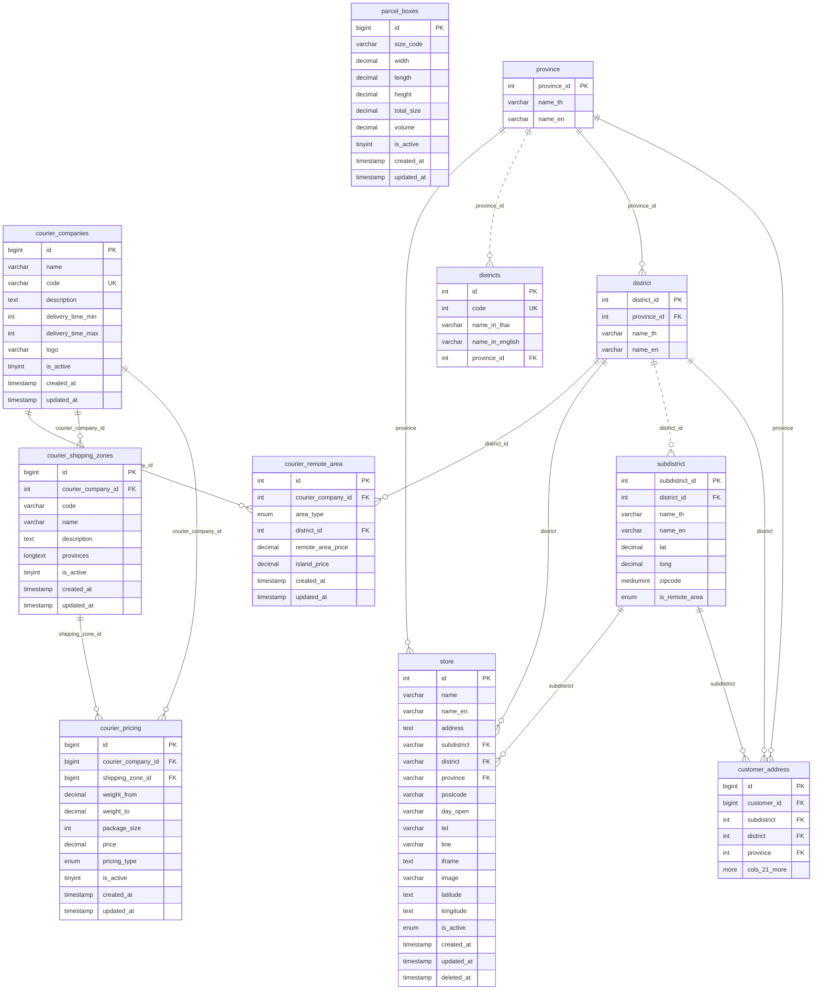

# แผนที่ฐานข้อมูล MITRAREE

ดึงโครงสร้างจริงจากฐานข้อมูลในเครื่องพัฒนา (local) วันที่ 1 พ.ย. 2569 มีเฉพาะโครงสร้าง ไม่มีข้อมูลลูกค้า

- ตารางทั้งหมด **122** · ใช้งาน **96** · ตารางของ Laravel **5** · ตารางสำรอง **21**
- ความสัมพันธ์ **131** เส้น

## ที่มาของความสัมพันธ์

| ป้าย | ความหมาย | จำนวน |
|---|---|---|
| FK จริง | ฐานข้อมูลบังคับไว้ | 9 |
| ใน Model | โค้ดใช้ความสัมพันธ์นี้ แต่ฐานไม่บังคับ | 95 |
| เดาจากชื่อ | ชื่อคอลัมน์บอกใบ้ ยังไม่ยืนยัน | 27 |

ในแผนภาพ เส้นทึบมาจาก FK จริงหรือ Model ส่วนเส้นประเดาจากชื่อคอลัมน์

> หมายเหตุ: ตาราง `group` แสดงในแผนภาพเป็น `group_` เพราะ `group` เป็นคำสงวนของ Mermaid

> TODO(dev): `orders.coupon_id` ยังไม่รู้ว่าชี้ไปตารางไหน จึงไม่ได้ลากเส้น

## สารบัญ

- [คำสั่งซื้อและการชำระเงิน](#orders)
- [สินค้าและสต็อก](#products)
- [ลูกค้าและสุขภาพ](#customers)
- [โปรโมชัน แต้ม คูปอง ตะกร้า](#promo)
- [ขนส่งและพื้นที่](#shipping)
- [หลังบ้านและเนื้อหา](#admin)
- [สคริปต์ CREATE TABLE](#sql)

<a id="orders"></a>

## คำสั่งซื้อและการชำระเงิน

ออเดอร์ รายการสินค้า การแพ็ก การจัดส่ง การจ่ายเงิน และการคืนเงิน

**ตารางในหมวดนี้** (แสดงทุกคอลัมน์)

| ตาราง | คอลัมน์ |
|---|---|
| `orders` | 54 |
| `order_lists` | 21 |
| `order_packing_logs` | 6 |
| `order_shipping` | 13 |
| `order_shipping_logs` | 5 |
| `order_tokens` | 8 |
| `order_refunds` | 21 |
| `paymen_logs` | 7 |
| `payment_shipping_errors` | 16 |
| `line_notify_outbox` | 12 |
| `lma_followup_outbox` | 10 |

**ตารางจากหมวดอื่นที่โยงมา** (แสดงเฉพาะคอลัมน์ key): `customers`, `store`, `customer_address`, `product`, `product_unit`, `promotion`, `my_coupons`, `admin`



**ความสัมพันธ์**

| คอลัมน์ลูก | ชี้ไปที่ | ที่มา |
|---|---|---|
| `orders.customer_id` | `customers.id` | ใน Model |
| `orders.store_id` | `store.id` | ใน Model |
| `orders.shipping_address_id` | `customer_address.id` | ใน Model |
| `orders.billing_address_id` | `customer_address.id` | ใน Model |
| `orders.created_by_staff_id` | `admin.id` | ใน Model |
| `order_lists.order_id` | `orders.id` | ใน Model |
| `order_lists.product_id` | `product.id` | ใน Model |
| `order_lists.unit_id` | `product_unit.id` | ใน Model |
| `order_lists.promotion_id` | `promotion.id` | ใน Model |
| `order_lists.coupon_id` | `my_coupons.id` | เดาจากชื่อ |
| `order_packing_logs.order_id` | `orders.id` | เดาจากชื่อ |
| `order_packing_logs.order_list_id` | `order_lists.id` | เดาจากชื่อ |
| `order_refunds.order_id` | `orders.id` | เดาจากชื่อ |
| `order_shipping.order_id` | `orders.id` | ใน Model |
| `order_shipping_logs.shipping_order_id` | `order_shipping.provider_order_id` | ใน Model |
| `order_tokens.order_id` | `orders.id` | ใน Model |
| `paymen_logs.payment_order_id` | `orders.id` | ใน Model |
| `payment_shipping_errors.order_id` | `orders.id` | ใน Model |
| `line_notify_outbox.order_id` | `orders.id` | ใน Model |
| `lma_followup_outbox.order_id` | `orders.id` | ใน Model |
| `lma_followup_outbox.symptom_record_id` | `symptom_records.id` | เดาจากชื่อ |

<a id="products"></a>

## สินค้าและสต็อก

สินค้า หน่วยขาย รูป หมวด แบรนด์ สต็อกแต่ละสาขา และประวัติการตัดสต็อก

**ตารางในหมวดนี้** (แสดงทุกคอลัมน์)

| ตาราง | คอลัมน์ |
|---|---|
| `product` | 19 |
| `product_unit` | 21 |
| `product_image` | 9 |
| `product_unit_barcode_alt` | 5 |
| `category` | 12 |
| `brand` | 7 |
| `related_product` | 5 |
| `group` | 8 |
| `group_product` | 9 |
| `discontinued_close_log` | 6 |
| `product_search_synonym` | 6 |
| `store` | 19 |
| `store_stock` | 12 |
| `stock_location` | 5 |
| `stock_logs` | 16 |
| `stock_deductions` | 9 |
| `stock_deduction_lines` | 7 |

**ตารางจากหมวดอื่นที่โยงมา** (แสดงเฉพาะคอลัมน์ key): `orders`



**ความสัมพันธ์**

| คอลัมน์ลูก | ชี้ไปที่ | ที่มา |
|---|---|---|
| `product.category_id` | `category.id` | ใน Model |
| `product.brand_id` | `brand.id` | ใน Model |
| `category.parent_id` | `category.id` | ใน Model |
| `product_image.product_id` | `product.id` | FK จริง |
| `product_unit.product_id` | `product.id` | FK จริง |
| `product_unit_barcode_alt.product_unit_id` | `product_unit.id` | เดาจากชื่อ |
| `related_product.product_id` | `product.id` | ใน Model |
| `related_product.related_product_id` | `product.id` | ใน Model |
| `group_product.product_id` | `product.id` | ใน Model |
| `group_product.group_id` | `group.id` | ใน Model |
| `discontinued_close_log.product_id` | `product.id` | เดาจากชื่อ |
| `store_stock.product_id` | `product.id` | FK จริง |
| `store_stock.unit_id` | `product_unit.id` | ใน Model |
| `store_stock.store_id` | `store.id` | ใน Model |
| `store_stock.location_id` | `stock_location.id` | เดาจากชื่อ |
| `stock_logs.product_id` | `product.id` | FK จริง |
| `stock_logs.unit_id` | `product_unit.id` | ใน Model |
| `stock_logs.store_id` | `store.id` | ใน Model |
| `stock_logs.location_id` | `stock_location.id` | ใน Model |
| `stock_logs.order_id` | `orders.id` | ใน Model |
| `stock_logs.customer_id` | `customers.id` | เดาจากชื่อ |
| `stock_deductions.order_id` | `orders.id` | เดาจากชื่อ |
| `stock_deductions.store_id` | `store.id` | เดาจากชื่อ |
| `stock_deduction_lines.order_id` | `orders.id` | เดาจากชื่อ |
| `stock_deduction_lines.product_id` | `product.id` | เดาจากชื่อ |
| `stock_deduction_lines.unit_id` | `product_unit.id` | เดาจากชื่อ |
| `store.subdistrict` | `subdistrict.subdistrict_id` | ใน Model |
| `store.district` | `district.district_id` | ใน Model |
| `store.province` | `province.province_id` | ใน Model |

<a id="customers"></a>

## ลูกค้าและสุขภาพ

ข้อมูลลูกค้า ที่อยู่ ยาที่ใช้ โรคประจำตัว การยินยอม และบันทึกอาการ

**ตารางในหมวดนี้** (แสดงทุกคอลัมน์)

| ตาราง | คอลัมน์ |
|---|---|
| `customers` | 28 |
| `customer_address` | 26 |
| `customer_business` | 13 |
| `customer_cards` | 10 |
| `customer_documents` | 9 |
| `customer_drugs` | 10 |
| `customer_favorites` | 8 |
| `customer_favorite_lists` | 9 |
| `customer_food_allergies` | 8 |
| `customer_congenital_diseases` | 8 |
| `congenital_diseases` | 8 |
| `symptoms` | 8 |
| `disease_symptom_relations` | 5 |
| `customer_market_consent` | 10 |
| `marketing_consent` | 7 |
| `customer_sensitive_information` | 10 |
| `sensitive_information` | 9 |
| `symptom_records` | 10 |
| `symptom_record_chips` | 2 |
| `symptom_chips` | 7 |

**ตารางจากหมวดอื่นที่โยงมา** (แสดงเฉพาะคอลัมน์ key): `product`, `orders`, `admin`



**ความสัมพันธ์**

| คอลัมน์ลูก | ชี้ไปที่ | ที่มา |
|---|---|---|
| `customer_address.customer_id` | `customers.id` | FK จริง |
| `customer_business.customer_id` | `customers.id` | ใน Model |
| `customer_cards.customer_id` | `customers.id` | ใน Model |
| `customer_documents.customer_id` | `customers.id` | ใน Model |
| `customer_drugs.customer_id` | `customers.id` | ใน Model |
| `customer_drugs.drug_id` | `product.id` | ใน Model |
| `customer_favorites.customer_id` | `customers.id` | ใน Model |
| `customer_favorite_lists.favorite_id` | `customer_favorites.id` | ใน Model |
| `customer_favorite_lists.drug_id` | `product.id` | ใน Model |
| `customer_food_allergies.customer_id` | `customers.id` | ใน Model |
| `customer_congenital_diseases.customer_id` | `customers.id` | FK จริง |
| `customer_congenital_diseases.congenital_disease_id` | `congenital_diseases.id` | FK จริง |
| `customer_market_consent.customer_id` | `customers.id` | ใน Model |
| `customer_market_consent.market_consent_id` | `marketing_consent.id` | ใน Model |
| `customer_sensitive_information.customer_id` | `customers.id` | ใน Model |
| `customer_sensitive_information.sensitive_information_id` | `sensitive_information.id` | ใน Model |
| `symptom_records.customer_id` | `customers.id` | ใน Model |
| `symptom_records.order_id` | `orders.id` | ใน Model |
| `symptom_records.created_by_staff_id` | `admin.id` | เดาจากชื่อ |
| `symptom_record_chips.record_id` | `symptom_records.id` | ใน Model |
| `symptom_record_chips.chip_id` | `symptom_chips.id` | ใน Model |
| `symptom_chips.created_by_staff_id` | `admin.id` | เดาจากชื่อ |
| `disease_symptom_relations.disease_id` | `congenital_diseases.id` | ใน Model |
| `disease_symptom_relations.symptom_id` | `symptoms.id` | ใน Model |
| `customer_address.subdistrict` | `subdistrict.subdistrict_id` | ใน Model |
| `customer_address.district` | `district.district_id` | ใน Model |
| `customer_address.province` | `province.province_id` | ใน Model |

<a id="promo"></a>

## โปรโมชัน แต้ม คูปอง ตะกร้า

โปรโมชัน คูปองแลกแต้ม แต้มสะสม รีวิว และตะกร้าสินค้า

**ตารางในหมวดนี้** (แสดงทุกคอลัมน์)

| ตาราง | คอลัมน์ |
|---|---|
| `promotion` | 26 |
| `promotion_product` | 17 |
| `promotion_transaction` | 7 |
| `point_coupon` | 26 |
| `point_coupon_detail` | 19 |
| `my_coupons` | 13 |
| `point_transactions` | 15 |
| `point_system` | 6 |
| `cart` | 6 |
| `cart_item` | 9 |
| `review_products` | 9 |
| `review_product_images` | 5 |
| `reviews_system` | 7 |

**ตารางจากหมวดอื่นที่โยงมา** (แสดงเฉพาะคอลัมน์ key): `customers`, `product`, `product_unit`, `orders`, `admin`



**ความสัมพันธ์**

| คอลัมน์ลูก | ชี้ไปที่ | ที่มา |
|---|---|---|
| `promotion_transaction.promotion_id` | `promotion.id` | ใน Model |
| `promotion_transaction.user_id` | `customers.id` | ใน Model |
| `promotion_transaction.order_id` | `orders.id` | ใน Model |
| `review_products.user_id` | `customers.id` | ใน Model |
| `review_products.product_id` | `product.id` | ใน Model |
| `review_products.order_id` | `orders.id` | ใน Model |
| `review_product_images.review_id` | `review_products.id` | ใน Model |
| `reviews_system.user_id` | `customers.id` | ใน Model |
| `promotion_product.promotion_id` | `promotion.id` | ใน Model |
| `promotion_product.item_id` | `product.id` | ใน Model |
| `promotion_product.item_unit` | `product_unit.id` | ใน Model |
| `point_coupon_detail.point_id` | `point_coupon.id` | ใน Model |
| `point_coupon_detail.product_id` | `product.id` | ใน Model |
| `point_coupon_detail.unit_id` | `product_unit.id` | ใน Model |
| `my_coupons.customer_id` | `customers.id` | ใน Model |
| `my_coupons.coupon_id` | `point_coupon.id` | ใน Model |
| `my_coupons.coupon_detail_id` | `point_coupon_detail.id` | ใน Model |
| `my_coupons.order_id` | `orders.id` | ใน Model |
| `point_transactions.customer_id` | `customers.id` | ใน Model |
| `point_transactions.admin_id` | `admin.id` | ใน Model |
| `cart.user_id` | `customers.id` | เดาจากชื่อ |
| `cart_item.cart_id` | `cart.id` | เดาจากชื่อ |
| `cart_item.product_id` | `product.id` | เดาจากชื่อ |
| `cart_item.promotion_id` | `promotion.id` | เดาจากชื่อ |

<a id="shipping"></a>

## ขนส่งและพื้นที่

บริษัทขนส่ง โซน ราคา พื้นที่ห่างไกล จังหวัด อำเภอ ตำบล และสาขา

**ตารางในหมวดนี้** (แสดงทุกคอลัมน์)

| ตาราง | คอลัมน์ |
|---|---|
| `courier_companies` | 10 |
| `courier_shipping_zones` | 9 |
| `courier_pricing` | 11 |
| `courier_remote_area` | 8 |
| `parcel_boxes` | 10 |
| `province` | 3 |
| `district` | 4 |
| `subdistrict` | 8 |
| `districts` | 5 |
| `store` | 19 |

**ตารางจากหมวดอื่นที่โยงมา** (แสดงเฉพาะคอลัมน์ key): `customer_address`



**ความสัมพันธ์**

| คอลัมน์ลูก | ชี้ไปที่ | ที่มา |
|---|---|---|
| `district.province_id` | `province.province_id` | ใน Model |
| `subdistrict.district_id` | `district.district_id` | เดาจากชื่อ |
| `districts.province_id` | `province.province_id` | เดาจากชื่อ |
| `store.subdistrict` | `subdistrict.subdistrict_id` | ใน Model |
| `store.district` | `district.district_id` | ใน Model |
| `store.province` | `province.province_id` | ใน Model |
| `courier_pricing.courier_company_id` | `courier_companies.id` | FK จริง |
| `courier_pricing.shipping_zone_id` | `courier_shipping_zones.id` | FK จริง |
| `courier_shipping_zones.courier_company_id` | `courier_companies.id` | ใน Model |
| `courier_remote_area.courier_company_id` | `courier_companies.id` | ใน Model |
| `courier_remote_area.district_id` | `district.district_id` | ใน Model |

<a id="admin"></a>

## หลังบ้านและเนื้อหา

พนักงาน สิทธิ์เมนู บันทึกการทำงาน บล็อก FAQ คุกกี้ และหน้าเว็บ

**ตารางในหมวดนี้** (แสดงทุกคอลัมน์)

| ตาราง | คอลัมน์ |
|---|---|
| `admin` | 23 |
| `admin_to_store` | 6 |
| `admin_store_file` | 8 |
| `admin_logs` | 12 |
| `menu` | 13 |
| `menu_permissions` | 5 |
| `permission` | 4 |
| `store` | 19 |
| `blog` | 17 |
| `blog_category` | 5 |
| `blog_album` | 5 |
| `blog_product` | 6 |
| `related_blog` | 5 |
| `faq` | 8 |
| `faq_category` | 6 |
| `banner` | 10 |
| `home_content` | 10 |
| `cookies` | 11 |
| `cookie_category` | 8 |
| `consent_logs` | 8 |
| `user_consent` | 11 |
| `user_consent_details` | 7 |
| `notice_policy` | 6 |
| `contact` | 7 |
| `data_request_forms` | 23 |
| `preorder_terms` | 7 |
| `ss_sync_runs` | 11 |

**ตารางจากหมวดอื่นที่โยงมา** (แสดงเฉพาะคอลัมน์ key): `customers`, `product`

```mermaid
erDiagram
  admin {
    int id PK
    varchar name
    varchar id_card
    date birth_date
    varchar email
    varchar phone
    varchar username
    varchar password
    int role
    int store_id FK
    varchar license_number
    varchar image
    enum is_active
    varchar address_no
    varchar address_moo
    varchar address_road
    varchar address_subdistrict
    varchar address_district
    varchar address_province
    varchar address_postcode
    timestamp created_at
    timestamp updated_at
    timestamp deleted_at
  }
  admin_to_store {
    int id PK
    int admin_id FK
    int store_id FK
    timestamp created_at
    timestamp updated_at
    timestamp deleted_at
  }
  admin_store_file {
    int id PK
    int admin_id FK
    int store_id FK
    varchar file_name
    varchar real_name
    timestamp created_at
    timestamp updated_at
    timestamp deleted_at
  }
  admin_logs {
    bigint id PK
    bigint admin_id FK
    varchar action
    varchar target_type
    bigint target_id
    varchar description
    longtext old_data
    longtext new_data
    varchar ip_address
    text user_agent
    timestamp created_at
    timestamp updated_at
  }
  menu {
    bigint id PK
    varchar name
    text url
    text icon
    enum position
    int parent_id FK
    int sort
    enum status
    int topic_id
    enum delete_status
    datetime created_at
    datetime updated_at
    datetime deleted_at
  }
  menu_permissions {
    int id PK
    int menu_id FK
    int permission_id FK
    timestamp created_at
    timestamp updated_at
  }
  permission {
    int id PK
    varchar name
    timestamp created_at
    timestamp updated_at
  }
  store {
    int id PK
    varchar name
    varchar name_en
    text address
    varchar subdistrict FK
    varchar district FK
    varchar province FK
    varchar postcode
    varchar day_open
    varchar tel
    varchar line
    text iframe
    varchar image
    text latitude
    text longitude
    enum is_active
    timestamp created_at
    timestamp updated_at
    timestamp deleted_at
  }
  blog {
    int id PK
    int blog_category_id FK
    varchar title
    varchar cover_image
    varchar banner_image
    text content
    int created_by
    int writer_id FK
    text writer_comment
    text writer_name
    varchar writer_image
    enum is_active
    enum show_banner
    int display_order
    timestamp created_at
    int popular
    timestamp updated_at
  }
  blog_category {
    int id PK
    varchar name
    enum is_active
    timestamp created_at
    timestamp updated_at
  }
  blog_album {
    int id PK
    int blog_id FK
    varchar image
    timestamp created_at
    timestamp updated_at
  }
  blog_product {
    int id PK
    int blog_id FK
    int product_id FK
    timestamp created_at
    timestamp updated_at
    timestamp deleted_at
  }
  related_blog {
    int id PK
    int blog_id FK
    int related_blog_id FK
    timestamp created_at
    timestamp updated_at
  }
  faq {
    int id PK
    int faq_category_id FK
    text question
    text answer
    int display_order
    enum is_active
    timestamp created_at
    timestamp updated_at
  }
  faq_category {
    int id PK
    varchar name
    int display_order
    enum is_active
    timestamp created_at
    timestamp updated_at
  }
  banner {
    int id PK
    varchar image
    text detail
    varchar name
    varchar link
    enum page
    int display_order
    enum is_active
    timestamp created_at
    timestamp updated_at
  }
  home_content {
    int id PK
    varchar part
    varchar name
    varchar detail
    varchar image
    varchar link
    varchar promotion_detail
    enum is_active
    timestamp created_at
    timestamp updated_at
  }
  cookies {
    int id PK
    int category_id FK
    varchar cookie_name
    varchar cookie_domain
    text purpose
    varchar duration
    varchar third_party_provider
    text privacy_policy_url
    enum is_active
    timestamp created_at
    timestamp updated_at
  }
  cookie_category {
    int id PK
    varchar category_code
    varchar category_name
    text description
    enum is_require
    enum is_active
    timestamp created_at
    timestamp updated_at
  }
  consent_logs {
    int id PK
    varchar user_identifier
    int category_id FK
    varchar previous_consent
    varchar new_consent
    varchar ip_address
    text user_agent
    timestamp action_timestamp
  }
  user_consent {
    int id PK
    varchar consent_id
    varchar user_identifier FK
    text ip_address
    text user_agent
    timestamp consent_timestamp
    varchar consent_version
    timestamp expires_at
    enum is_active
    timestamp created_at
    timestamp updated_at
  }
  user_consent_details {
    int id PK
    varchar consent_id FK
    int category_id FK
    enum is_consented
    timestamp consent_timestamp
    timestamp created_at
    timestamp updated_at
  }
  notice_policy {
    int id
    varchar title
    longtext content
    enum type
    timestamp created_at
    timestamp updated_at
  }
  contact {
    int id
    varchar image
    varchar name
    varchar link
    enum is_active
    timestamp created_at
    timestamp updated_at
  }
  data_request_forms {
    bigint id PK
    enum petitioner_type
    varchar full_name
    varchar id_card_number
    varchar phone_number
    varchar email
    varchar owner_full_name
    text owner_address
    varchar owner_phone_number
    varchar owner_email
    enum identity_doc_type
    text identity_doc_file_path
    text authorization_doc_file_path
    enum relation_status
    text relation_status_other
    text rights_requested
    text other_right
    text request_reason
    enum status
    timestamp created_at
    timestamp updated_at
    timestamp submit_at
    int submit_by
  }
  preorder_terms {
    bigint id PK
    varchar version
    varchar locale
    longtext body_text
    char sha256
    timestamp published_at
    bigint published_by
  }
  ss_sync_runs {
    bigint id PK
    timestamp started_at
    timestamp finished_at
    varchar status
    tinyint dry_run
    varchar only
    date snapshot_date
    longtext results
    text error
    timestamp created_at
    timestamp updated_at
  }
  customers {
    bigint id PK
    more cols_27_more
  }
  product {
    int id PK
    int category_id FK
    int brand_id FK
    more cols_16_more
  }
  admin ||--o{ admin_to_store : "admin_id"
  store ||--o{ admin_to_store : "store_id"
  admin ||..o{ admin_store_file : "admin_id"
  store ||..o{ admin_store_file : "store_id"
  blog_category ||--o{ blog : "blog_category_id"
  admin ||--o{ blog : "writer_id"
  blog ||--o{ blog_album : "blog_id"
  blog ||--o{ blog_product : "blog_id"
  product ||--o{ blog_product : "product_id"
  blog ||--o{ related_blog : "blog_id"
  blog ||--o{ related_blog : "related_blog_id"
  faq_category ||--o{ faq : "faq_category_id"
  menu ||..o{ menu : "parent_id"
  menu ||--o{ menu_permissions : "menu_id"
  permission ||--o{ menu_permissions : "permission_id"
  admin ||--o{ admin_logs : "admin_id"
  store ||..o{ admin : "store_id"
  cookie_category ||--o{ cookies : "category_id"
  cookie_category ||..o{ consent_logs : "category_id"
  user_consent ||--o{ user_consent_details : "consent_id"
  cookie_category ||--o{ user_consent_details : "category_id"
  customers ||--o{ user_consent : "user_identifier"
```



**ความสัมพันธ์**

| คอลัมน์ลูก | ชี้ไปที่ | ที่มา |
|---|---|---|
| `admin_to_store.admin_id` | `admin.id` | ใน Model |
| `admin_to_store.store_id` | `store.id` | ใน Model |
| `admin_store_file.admin_id` | `admin.id` | เดาจากชื่อ |
| `admin_store_file.store_id` | `store.id` | เดาจากชื่อ |
| `store.subdistrict` | `subdistrict.subdistrict_id` | ใน Model |
| `store.district` | `district.district_id` | ใน Model |
| `store.province` | `province.province_id` | ใน Model |
| `blog.blog_category_id` | `blog_category.id` | ใน Model |
| `blog.writer_id` | `admin.id` | ใน Model |
| `blog_album.blog_id` | `blog.id` | ใน Model |
| `blog_product.blog_id` | `blog.id` | ใน Model |
| `blog_product.product_id` | `product.id` | ใน Model |
| `related_blog.blog_id` | `blog.id` | ใน Model |
| `related_blog.related_blog_id` | `blog.id` | ใน Model |
| `faq.faq_category_id` | `faq_category.id` | ใน Model |
| `menu.parent_id` | `menu.id` | เดาจากชื่อ |
| `menu_permissions.menu_id` | `menu.id` | ใน Model |
| `menu_permissions.permission_id` | `permission.id` | ใน Model |
| `admin_logs.admin_id` | `admin.id` | ใน Model |
| `admin.store_id` | `store.id` | เดาจากชื่อ |
| `cookies.category_id` | `cookie_category.id` | ใน Model |
| `consent_logs.category_id` | `cookie_category.id` | เดาจากชื่อ |
| `user_consent_details.consent_id` | `user_consent.consent_id` | ใน Model |
| `user_consent_details.category_id` | `cookie_category.id` | ใน Model |
| `user_consent.user_identifier` | `customers.id` | ใน Model |

<a id="sql"></a>

## สคริปต์ CREATE TABLE

101 ตาราง ไม่รวมตารางสำรอง สร้างจาก `SHOW CREATE TABLE` ตรงกับฐานในเครื่องทุกคอลัมน์ ดัชนี และ FK ใช้กับ MySQL หรือ MariaDB ได้

ตารางสำรองที่ไม่ได้ใส่: `barcode_review_2026_08_11`, `lma_followup_outbox_backup_pre_test_purge`, `member_price_backup_pre_phase2`, `my_coupons_backup_pre_test_purge`, `order_lists_backup_pre_test_purge`, `order_packing_logs_backup_pre_test_purge`, `order_shipping_backup_pre_test_purge`, `order_shipping_logs_backup_pre_test_purge`, `order_tokens_backup_pre_test_purge`, `orders_backup_pre_test_purge`, `paymen_logs_backup_pre_test_purge`, `payment_shipping_errors_backup_pre_test_purge`, `point_transactions_backup_pre_test_purge`, `product_unit_barcode_backup`, `promotion_transaction_backup_pre_test_purge`, `review_products_backup_pre_test_purge`, `stock_logs_backup_pre_branch_purge`, `stock_logs_backup_pre_test_purge`, `store_backup_pre_branch_purge`, `store_stock_backup_pre_branch_purge`, `symptom_records_backup_pre_test_purge`

<details>
<summary>ดูสคริปต์ทั้งหมด</summary>

```sql
-- MITRAREE schema (structure only, no data)
-- Generated 2026-11-01 from local development database

SET NAMES utf8mb4;
SET FOREIGN_KEY_CHECKS = 0;

-- ----------------------------
-- admin
-- ----------------------------
DROP TABLE IF EXISTS `admin`;
CREATE TABLE `admin` (
  `id` int NOT NULL AUTO_INCREMENT,
  `name` varchar(255) COLLATE utf8mb4_general_ci NOT NULL,
  `id_card` varchar(15) COLLATE utf8mb4_general_ci DEFAULT NULL,
  `birth_date` date DEFAULT NULL,
  `email` varchar(255) COLLATE utf8mb4_general_ci NOT NULL,
  `phone` varchar(20) COLLATE utf8mb4_general_ci DEFAULT NULL,
  `username` varchar(255) COLLATE utf8mb4_general_ci NOT NULL,
  `password` varchar(255) COLLATE utf8mb4_general_ci NOT NULL,
  `role` int NOT NULL COMMENT '1-หลัก , 2-Support , 3-เภสัช , 4-เซล',
  `store_id` int DEFAULT NULL COMMENT 'ย้ายไป admin_to_store',
  `license_number` varchar(50) COLLATE utf8mb4_general_ci DEFAULT NULL COMMENT 'เลขที่ใบอนุญาต',
  `image` varchar(255) COLLATE utf8mb4_general_ci DEFAULT NULL,
  `is_active` enum('yes','no') COLLATE utf8mb4_general_ci NOT NULL,
  `address_no` varchar(50) COLLATE utf8mb4_general_ci DEFAULT NULL,
  `address_moo` varchar(20) COLLATE utf8mb4_general_ci DEFAULT NULL,
  `address_road` varchar(50) COLLATE utf8mb4_general_ci DEFAULT NULL,
  `address_subdistrict` varchar(50) COLLATE utf8mb4_general_ci DEFAULT NULL,
  `address_district` varchar(50) COLLATE utf8mb4_general_ci DEFAULT NULL,
  `address_province` varchar(50) COLLATE utf8mb4_general_ci DEFAULT NULL,
  `address_postcode` varchar(10) COLLATE utf8mb4_general_ci DEFAULT NULL,
  `created_at` timestamp NULL DEFAULT NULL,
  `updated_at` timestamp NULL DEFAULT NULL,
  `deleted_at` timestamp NULL DEFAULT NULL,
  PRIMARY KEY (`id`)
) ENGINE=InnoDB DEFAULT CHARSET=utf8mb4 COLLATE=utf8mb4_general_ci;

-- ----------------------------
-- admin_logs
-- ----------------------------
DROP TABLE IF EXISTS `admin_logs`;
CREATE TABLE `admin_logs` (
  `id` bigint unsigned NOT NULL AUTO_INCREMENT,
  `admin_id` bigint unsigned NOT NULL,
  `action` varchar(255) CHARACTER SET utf8mb4 COLLATE utf8mb4_unicode_ci NOT NULL,
  `target_type` varchar(255) CHARACTER SET utf8mb4 COLLATE utf8mb4_unicode_ci DEFAULT NULL,
  `target_id` bigint unsigned DEFAULT NULL,
  `description` varchar(255) CHARACTER SET utf8mb4 COLLATE utf8mb4_unicode_ci NOT NULL,
  `old_data` longtext CHARACTER SET utf8mb4 COLLATE utf8mb4_bin,
  `new_data` longtext CHARACTER SET utf8mb4 COLLATE utf8mb4_bin,
  `ip_address` varchar(255) CHARACTER SET utf8mb4 COLLATE utf8mb4_unicode_ci NOT NULL,
  `user_agent` text CHARACTER SET utf8mb4 COLLATE utf8mb4_unicode_ci NOT NULL,
  `created_at` timestamp NULL DEFAULT NULL,
  `updated_at` timestamp NULL DEFAULT NULL,
  PRIMARY KEY (`id`),
  KEY `admin_logs_admin_id_created_at_index` (`admin_id`,`created_at`),
  KEY `admin_logs_action_index` (`action`),
  KEY `admin_logs_target_type_target_id_index` (`target_type`,`target_id`)
) ENGINE=InnoDB DEFAULT CHARSET=utf8mb3;

-- ----------------------------
-- admin_store_file
-- ----------------------------
DROP TABLE IF EXISTS `admin_store_file`;
CREATE TABLE `admin_store_file` (
  `id` int NOT NULL AUTO_INCREMENT,
  `admin_id` int NOT NULL,
  `store_id` int DEFAULT NULL,
  `file_name` varchar(200) COLLATE utf8mb3_unicode_ci NOT NULL,
  `real_name` varchar(200) COLLATE utf8mb3_unicode_ci DEFAULT NULL,
  `created_at` timestamp NULL DEFAULT NULL,
  `updated_at` timestamp NULL DEFAULT NULL,
  `deleted_at` timestamp NULL DEFAULT NULL,
  PRIMARY KEY (`id`)
) ENGINE=InnoDB DEFAULT CHARSET=utf8mb3 COLLATE=utf8mb3_unicode_ci;

-- ----------------------------
-- admin_to_store
-- ----------------------------
DROP TABLE IF EXISTS `admin_to_store`;
CREATE TABLE `admin_to_store` (
  `id` int NOT NULL AUTO_INCREMENT,
  `admin_id` int NOT NULL,
  `store_id` int NOT NULL,
  `created_at` timestamp NULL DEFAULT NULL,
  `updated_at` timestamp NULL DEFAULT NULL,
  `deleted_at` timestamp NULL DEFAULT NULL,
  PRIMARY KEY (`id`)
) ENGINE=InnoDB DEFAULT CHARSET=utf8mb3 COLLATE=utf8mb3_unicode_ci;

-- ----------------------------
-- banner
-- ----------------------------
DROP TABLE IF EXISTS `banner`;
CREATE TABLE `banner` (
  `id` int NOT NULL AUTO_INCREMENT,
  `image` varchar(255) COLLATE utf8mb3_unicode_ci DEFAULT NULL,
  `detail` text COLLATE utf8mb3_unicode_ci,
  `name` varchar(255) COLLATE utf8mb3_unicode_ci DEFAULT NULL,
  `link` varchar(255) COLLATE utf8mb3_unicode_ci DEFAULT NULL,
  `page` enum('home','contact_us') COLLATE utf8mb3_unicode_ci DEFAULT NULL,
  `display_order` int DEFAULT NULL,
  `is_active` enum('yes','no') COLLATE utf8mb3_unicode_ci DEFAULT NULL,
  `created_at` timestamp NULL DEFAULT NULL,
  `updated_at` timestamp NULL DEFAULT NULL,
  PRIMARY KEY (`id`)
) ENGINE=InnoDB DEFAULT CHARSET=utf8mb3 COLLATE=utf8mb3_unicode_ci;

-- ----------------------------
-- blog
-- ----------------------------
DROP TABLE IF EXISTS `blog`;
CREATE TABLE `blog` (
  `id` int NOT NULL AUTO_INCREMENT,
  `blog_category_id` int NOT NULL,
  `title` varchar(255) COLLATE utf8mb3_unicode_ci DEFAULT NULL,
  `cover_image` varchar(255) COLLATE utf8mb3_unicode_ci DEFAULT NULL,
  `banner_image` varchar(255) COLLATE utf8mb3_unicode_ci DEFAULT NULL,
  `content` text COLLATE utf8mb3_unicode_ci,
  `created_by` int DEFAULT NULL,
  `writer_id` int DEFAULT NULL COMMENT 'สำหรับแสดงผลหน้าบ้าน',
  `writer_comment` text COLLATE utf8mb3_unicode_ci,
  `writer_name` text COLLATE utf8mb3_unicode_ci,
  `writer_image` varchar(255) COLLATE utf8mb3_unicode_ci DEFAULT NULL,
  `is_active` enum('yes','no') COLLATE utf8mb3_unicode_ci NOT NULL,
  `show_banner` enum('yes','no') COLLATE utf8mb3_unicode_ci DEFAULT NULL,
  `display_order` int DEFAULT NULL,
  `created_at` timestamp NULL DEFAULT NULL,
  `popular` int DEFAULT '0' COMMENT '0 =ไม่นิยม / 1= เป็นบทความนิยม',
  `updated_at` timestamp NULL DEFAULT NULL,
  PRIMARY KEY (`id`)
) ENGINE=InnoDB DEFAULT CHARSET=utf8mb3 COLLATE=utf8mb3_unicode_ci;

-- ----------------------------
-- blog_album
-- ----------------------------
DROP TABLE IF EXISTS `blog_album`;
CREATE TABLE `blog_album` (
  `id` int NOT NULL AUTO_INCREMENT,
  `blog_id` int NOT NULL,
  `image` varchar(255) COLLATE utf8mb3_unicode_ci NOT NULL,
  `created_at` timestamp NULL DEFAULT NULL,
  `updated_at` timestamp NULL DEFAULT NULL,
  PRIMARY KEY (`id`)
) ENGINE=InnoDB DEFAULT CHARSET=utf8mb3 COLLATE=utf8mb3_unicode_ci;

-- ----------------------------
-- blog_category
-- ----------------------------
DROP TABLE IF EXISTS `blog_category`;
CREATE TABLE `blog_category` (
  `id` int NOT NULL AUTO_INCREMENT,
  `name` varchar(200) COLLATE utf8mb3_unicode_ci NOT NULL,
  `is_active` enum('yes','no') COLLATE utf8mb3_unicode_ci NOT NULL,
  `created_at` timestamp NULL DEFAULT NULL,
  `updated_at` timestamp NULL DEFAULT NULL,
  PRIMARY KEY (`id`)
) ENGINE=InnoDB DEFAULT CHARSET=utf8mb3 COLLATE=utf8mb3_unicode_ci;

-- ----------------------------
-- blog_product
-- ----------------------------
DROP TABLE IF EXISTS `blog_product`;
CREATE TABLE `blog_product` (
  `id` int NOT NULL AUTO_INCREMENT,
  `blog_id` int NOT NULL,
  `product_id` int NOT NULL,
  `created_at` timestamp NULL DEFAULT NULL,
  `updated_at` timestamp NULL DEFAULT NULL,
  `deleted_at` timestamp NULL DEFAULT NULL,
  PRIMARY KEY (`id`)
) ENGINE=InnoDB DEFAULT CHARSET=utf8mb3 COLLATE=utf8mb3_unicode_ci COMMENT='สินค้าที่แสดงในบทความ';

-- ----------------------------
-- brand
-- ----------------------------
DROP TABLE IF EXISTS `brand`;
CREATE TABLE `brand` (
  `id` bigint NOT NULL AUTO_INCREMENT,
  `name` varchar(255) COLLATE utf8mb4_general_ci DEFAULT NULL,
  `description` varchar(255) COLLATE utf8mb4_general_ci DEFAULT NULL,
  `is_active` enum('yes','no') COLLATE utf8mb4_general_ci DEFAULT NULL,
  `created_at` timestamp NULL DEFAULT CURRENT_TIMESTAMP,
  `updated_at` timestamp NULL DEFAULT CURRENT_TIMESTAMP ON UPDATE CURRENT_TIMESTAMP,
  `deleted_at` timestamp NULL DEFAULT NULL,
  PRIMARY KEY (`id`)
) ENGINE=InnoDB DEFAULT CHARSET=utf8mb4 COLLATE=utf8mb4_general_ci COMMENT='แบรนด์สินค้า';

-- ----------------------------
-- cart
-- ----------------------------
DROP TABLE IF EXISTS `cart`;
CREATE TABLE `cart` (
  `id` int NOT NULL,
  `user_id` int NOT NULL,
  `session_id` varchar(100) COLLATE utf8mb3_unicode_ci DEFAULT NULL COMMENT 'สำหรับยังไม่ล็อคอิน?',
  `created_at` timestamp NULL DEFAULT NULL,
  `updated_at` timestamp NULL DEFAULT NULL,
  `status` enum('on','off') COLLATE utf8mb3_unicode_ci NOT NULL
) ENGINE=InnoDB DEFAULT CHARSET=utf8mb3 COLLATE=utf8mb3_unicode_ci;

-- ----------------------------
-- cart_item
-- ----------------------------
DROP TABLE IF EXISTS `cart_item`;
CREATE TABLE `cart_item` (
  `id` int NOT NULL AUTO_INCREMENT,
  `cart_id` int NOT NULL,
  `product_id` int NOT NULL,
  `quantity` int NOT NULL,
  `promotion_id` int NOT NULL,
  `price_incart` decimal(10,2) DEFAULT NULL COMMENT 'ราคาวันที่เอาเข้าตะกร้า',
  `total` decimal(10,2) DEFAULT NULL,
  `created_at` timestamp NULL DEFAULT NULL,
  `updated_at` timestamp NULL DEFAULT NULL,
  PRIMARY KEY (`id`)
) ENGINE=InnoDB DEFAULT CHARSET=utf8mb3 COLLATE=utf8mb3_unicode_ci;

-- ----------------------------
-- category
-- ----------------------------
DROP TABLE IF EXISTS `category`;
CREATE TABLE `category` (
  `id` bigint NOT NULL AUTO_INCREMENT,
  `category` varchar(255) COLLATE utf8mb4_general_ci DEFAULT NULL,
  `category_code` varchar(40) COLLATE utf8mb4_general_ci DEFAULT NULL,
  `detail` varchar(255) COLLATE utf8mb4_general_ci DEFAULT NULL,
  `level` int DEFAULT NULL,
  `parent_id` int DEFAULT NULL,
  `is_active` enum('yes','no') COLLATE utf8mb4_general_ci NOT NULL,
  `created_at` timestamp NULL DEFAULT CURRENT_TIMESTAMP,
  `updated_at` timestamp NULL DEFAULT CURRENT_TIMESTAMP ON UPDATE CURRENT_TIMESTAMP,
  `created_by` varchar(50) COLLATE utf8mb4_general_ci DEFAULT NULL,
  `updated_by` varchar(50) COLLATE utf8mb4_general_ci DEFAULT NULL,
  `deleted_at` timestamp NULL DEFAULT NULL,
  PRIMARY KEY (`id`)
) ENGINE=InnoDB DEFAULT CHARSET=utf8mb4 COLLATE=utf8mb4_general_ci COMMENT='หมวดหมู่สินค้า';

-- ----------------------------
-- congenital_diseases
-- ----------------------------
DROP TABLE IF EXISTS `congenital_diseases`;
CREATE TABLE `congenital_diseases` (
  `id` bigint NOT NULL AUTO_INCREMENT,
  `name_th` text COLLATE utf8mb4_general_ci NOT NULL COMMENT 'ชื่อโรคภาษาไทย',
  `name_en` text COLLATE utf8mb4_general_ci COMMENT 'ชื่อโรคภาษาอังกฤษ',
  `active` tinyint(1) DEFAULT NULL,
  `created_by` varchar(255) COLLATE utf8mb4_general_ci DEFAULT NULL,
  `updated_by` varchar(255) COLLATE utf8mb4_general_ci DEFAULT NULL,
  `created_at` timestamp NULL DEFAULT CURRENT_TIMESTAMP,
  `updated_at` timestamp NULL DEFAULT CURRENT_TIMESTAMP ON UPDATE CURRENT_TIMESTAMP,
  PRIMARY KEY (`id`)
) ENGINE=InnoDB DEFAULT CHARSET=utf8mb4 COLLATE=utf8mb4_general_ci COMMENT='ตารางโรคประจำตัว';

-- ----------------------------
-- consent_logs
-- ----------------------------
DROP TABLE IF EXISTS `consent_logs`;
CREATE TABLE `consent_logs` (
  `id` int NOT NULL AUTO_INCREMENT,
  `user_identifier` varchar(255) COLLATE utf8mb3_unicode_ci NOT NULL,
  `category_id` int NOT NULL,
  `previous_consent` varchar(100) COLLATE utf8mb3_unicode_ci NOT NULL,
  `new_consent` varchar(100) COLLATE utf8mb3_unicode_ci NOT NULL,
  `ip_address` varchar(100) COLLATE utf8mb3_unicode_ci NOT NULL,
  `user_agent` text COLLATE utf8mb3_unicode_ci NOT NULL,
  `action_timestamp` timestamp NULL DEFAULT NULL,
  PRIMARY KEY (`id`)
) ENGINE=InnoDB DEFAULT CHARSET=utf8mb3 COLLATE=utf8mb3_unicode_ci;

-- ----------------------------
-- contact
-- ----------------------------
DROP TABLE IF EXISTS `contact`;
CREATE TABLE `contact` (
  `id` int NOT NULL,
  `image` varchar(255) COLLATE utf8mb3_unicode_ci DEFAULT NULL,
  `name` varchar(100) COLLATE utf8mb3_unicode_ci DEFAULT NULL,
  `link` varchar(255) COLLATE utf8mb3_unicode_ci DEFAULT NULL,
  `is_active` enum('yes','no') COLLATE utf8mb3_unicode_ci NOT NULL,
  `created_at` timestamp NULL DEFAULT NULL,
  `updated_at` timestamp NULL DEFAULT NULL
) ENGINE=InnoDB DEFAULT CHARSET=utf8mb3 COLLATE=utf8mb3_unicode_ci;

-- ----------------------------
-- cookie_category
-- ----------------------------
DROP TABLE IF EXISTS `cookie_category`;
CREATE TABLE `cookie_category` (
  `id` int NOT NULL AUTO_INCREMENT,
  `category_code` varchar(100) COLLATE utf8mb3_unicode_ci NOT NULL,
  `category_name` varchar(100) COLLATE utf8mb3_unicode_ci NOT NULL,
  `description` text COLLATE utf8mb3_unicode_ci,
  `is_require` enum('yes','no') COLLATE utf8mb3_unicode_ci NOT NULL DEFAULT 'no' COMMENT 'ถ้าจำเป็น จะปิดเปิดไม่ได้ away เปิด',
  `is_active` enum('yes','no') COLLATE utf8mb3_unicode_ci NOT NULL DEFAULT 'yes',
  `created_at` timestamp NULL DEFAULT NULL,
  `updated_at` timestamp NULL DEFAULT NULL,
  PRIMARY KEY (`id`)
) ENGINE=InnoDB DEFAULT CHARSET=utf8mb3 COLLATE=utf8mb3_unicode_ci;

-- ----------------------------
-- cookies
-- ----------------------------
DROP TABLE IF EXISTS `cookies`;
CREATE TABLE `cookies` (
  `id` int NOT NULL AUTO_INCREMENT,
  `category_id` int NOT NULL,
  `cookie_name` varchar(200) COLLATE utf8mb3_unicode_ci NOT NULL,
  `cookie_domain` varchar(200) COLLATE utf8mb3_unicode_ci DEFAULT NULL,
  `purpose` text COLLATE utf8mb3_unicode_ci NOT NULL,
  `duration` varchar(100) COLLATE utf8mb3_unicode_ci NOT NULL COMMENT 'ระยะเวลาที่คุกกี้จะถูกเก็บไว้',
  `third_party_provider` varchar(100) COLLATE utf8mb3_unicode_ci DEFAULT NULL COMMENT 'เผื่อใช้คุ้กกี้จากที่อื่น เช่น google',
  `privacy_policy_url` text COLLATE utf8mb3_unicode_ci COMMENT 'url จากแหล่งอื่น',
  `is_active` enum('yes','no') COLLATE utf8mb3_unicode_ci NOT NULL,
  `created_at` timestamp NULL DEFAULT NULL,
  `updated_at` timestamp NULL DEFAULT NULL,
  PRIMARY KEY (`id`)
) ENGINE=InnoDB DEFAULT CHARSET=utf8mb3 COLLATE=utf8mb3_unicode_ci;

-- ----------------------------
-- courier_companies
-- ----------------------------
DROP TABLE IF EXISTS `courier_companies`;
CREATE TABLE `courier_companies` (
  `id` bigint unsigned NOT NULL AUTO_INCREMENT COMMENT 'รหัสบริษัทขนส่ง (Primary Key)',
  `name` varchar(255) COLLATE utf8mb4_unicode_ci NOT NULL COMMENT 'ชื่อบริษัทขนส่ง เช่น Flash Express',
  `code` varchar(255) COLLATE utf8mb4_unicode_ci NOT NULL COMMENT 'รหัสบริษัท เช่น flash, dhl',
  `description` text COLLATE utf8mb4_unicode_ci COMMENT 'รายละเอียดบริษัทขนส่ง',
  `delivery_time_min` int NOT NULL DEFAULT '3' COMMENT 'เวลาจัดส่งขั้นต่ำ (วัน)',
  `delivery_time_max` int NOT NULL DEFAULT '5' COMMENT 'เวลาจัดส่งสูงสุด (วัน)',
  `logo` varchar(255) COLLATE utf8mb4_unicode_ci DEFAULT NULL COMMENT 'URL โลโก้บริษัทขนส่ง',
  `is_active` tinyint(1) NOT NULL DEFAULT '1' COMMENT 'สถานะใช้งาน (1=เปิดใช้งาน, 0=ปิด)',
  `created_at` timestamp NULL DEFAULT NULL COMMENT 'วันที่สร้างข้อมูล',
  `updated_at` timestamp NULL DEFAULT NULL COMMENT 'วันที่แก้ไขข้อมูลล่าสุด',
  PRIMARY KEY (`id`),
  UNIQUE KEY `courier_companies_code_unique` (`code`)
) ENGINE=InnoDB DEFAULT CHARSET=utf8mb4 COLLATE=utf8mb4_unicode_ci COMMENT='เก็บข้อมูลบริษัทขนส่ง';

-- ----------------------------
-- courier_pricing
-- ----------------------------
DROP TABLE IF EXISTS `courier_pricing`;
CREATE TABLE `courier_pricing` (
  `id` bigint unsigned NOT NULL AUTO_INCREMENT COMMENT 'รหัสราคาขนส่ง (Primary Key)',
  `courier_company_id` bigint unsigned NOT NULL COMMENT 'รหัสบริษัทขนส่ง (FK -> courier_companies.id)',
  `shipping_zone_id` bigint unsigned NOT NULL COMMENT 'รหัสโซนจัดส่ง (FK -> courier_shipping_zones.id)',
  `weight_from` decimal(5,2) NOT NULL DEFAULT '0.00' COMMENT 'น้ำหนักขั้นต่ำ (กก.)',
  `weight_to` decimal(5,2) NOT NULL COMMENT 'น้ำหนักสูงสุด (กก.)',
  `package_size` int DEFAULT NULL,
  `price` decimal(8,2) NOT NULL COMMENT 'ราคาค่าจัดส่ง',
  `pricing_type` enum('fixed','per_kg') COLLATE utf8mb4_unicode_ci NOT NULL DEFAULT 'fixed' COMMENT 'ประเภทการคิดราคา: fixed=ราคาเหมา, per_kg=ตามน้ำหนัก',
  `is_active` tinyint(1) NOT NULL DEFAULT '1' COMMENT 'สถานะใช้งาน (1=เปิดใช้งาน, 0=ปิด)',
  `created_at` timestamp NULL DEFAULT NULL COMMENT 'วันที่สร้างข้อมูล',
  `updated_at` timestamp NULL DEFAULT NULL COMMENT 'วันที่แก้ไขข้อมูลล่าสุด',
  PRIMARY KEY (`id`),
  KEY `courier_company_id_fk` (`courier_company_id`),
  KEY `shipping_zone_id_fk` (`shipping_zone_id`),
  KEY `pricing_company_zone_weight_idx` (`courier_company_id`,`shipping_zone_id`,`weight_from`,`weight_to`),
  CONSTRAINT `courier_pricing_courier_company_id_foreign` FOREIGN KEY (`courier_company_id`) REFERENCES `courier_companies` (`id`) ON DELETE CASCADE,
  CONSTRAINT `courier_pricing_shipping_zone_id_foreign` FOREIGN KEY (`shipping_zone_id`) REFERENCES `courier_shipping_zones` (`id`) ON DELETE CASCADE
) ENGINE=InnoDB DEFAULT CHARSET=utf8mb4 COLLATE=utf8mb4_unicode_ci COMMENT='เก็บข้อมูลราคาจัดส่งแยกตามบริษัทและโซน';

-- ----------------------------
-- courier_remote_area
-- ----------------------------
DROP TABLE IF EXISTS `courier_remote_area`;
CREATE TABLE `courier_remote_area` (
  `id` int NOT NULL AUTO_INCREMENT,
  `courier_company_id` int NOT NULL,
  `area_type` enum('remote','island') COLLATE utf8mb3_unicode_ci NOT NULL DEFAULT 'remote' COMMENT 'remote พื้นที่ห่างไกล\r\nisland หมูเกาะ',
  `district_id` int NOT NULL,
  `remote_area_price` decimal(10,2) NOT NULL DEFAULT '0.00',
  `island_price` decimal(10,2) DEFAULT '0.00',
  `created_at` timestamp NULL DEFAULT NULL,
  `updated_at` timestamp NULL DEFAULT NULL,
  PRIMARY KEY (`id`)
) ENGINE=InnoDB DEFAULT CHARSET=utf8mb3 COLLATE=utf8mb3_unicode_ci;

-- ----------------------------
-- courier_shipping_zones
-- ----------------------------
DROP TABLE IF EXISTS `courier_shipping_zones`;
CREATE TABLE `courier_shipping_zones` (
  `id` bigint unsigned NOT NULL AUTO_INCREMENT COMMENT 'รหัสโซน (Primary Key)',
  `courier_company_id` int NOT NULL,
  `code` varchar(255) CHARACTER SET utf8mb4 COLLATE utf8mb4_unicode_ci NOT NULL COMMENT 'รหัสโซน เช่น bangkok, central',
  `name` varchar(255) CHARACTER SET utf8mb4 COLLATE utf8mb4_unicode_ci NOT NULL COMMENT 'ชื่อโซน เช่น กรุงเทพมหานครและปริมณฑล',
  `description` text CHARACTER SET utf8mb4 COLLATE utf8mb4_unicode_ci COMMENT 'รายละเอียดเพิ่มเติมของโซน',
  `provinces` longtext CHARACTER SET utf8mb4 COLLATE utf8mb4_bin NOT NULL COMMENT 'รายชื่อจังหวัดในโซนนี้ (เก็บในรูปแบบ JSON)',
  `is_active` tinyint(1) NOT NULL DEFAULT '1' COMMENT 'สถานะใช้งาน (1=เปิดใช้งาน, 0=ปิด)',
  `created_at` timestamp NULL DEFAULT NULL COMMENT 'วันที่สร้างข้อมูล',
  `updated_at` timestamp NULL DEFAULT NULL COMMENT 'วันที่แก้ไขข้อมูลล่าสุด',
  PRIMARY KEY (`id`)
) ENGINE=InnoDB DEFAULT CHARSET=utf8mb3;

-- ----------------------------
-- customer_address
-- ----------------------------
DROP TABLE IF EXISTS `customer_address`;
CREATE TABLE `customer_address` (
  `id` bigint NOT NULL AUTO_INCREMENT,
  `customer_id` bigint NOT NULL COMMENT 'รหัสลูกค้า',
  `firstname` varchar(500) COLLATE utf8mb4_general_ci DEFAULT NULL,
  `lastname` varchar(500) COLLATE utf8mb4_general_ci DEFAULT NULL,
  `phone` varchar(20) COLLATE utf8mb4_general_ci DEFAULT NULL,
  `registration_number` varchar(50) COLLATE utf8mb4_general_ci DEFAULT NULL COMMENT 'เลขที่จดทะเบียนนิติบุคคล',
  `address` text COLLATE utf8mb4_general_ci COMMENT 'ที่อยู่',
  `village` varchar(500) COLLATE utf8mb4_general_ci DEFAULT NULL COMMENT 'หมู่บ้าน',
  `alley` varchar(500) COLLATE utf8mb4_general_ci DEFAULT NULL COMMENT 'ซอย',
  `road` varchar(500) COLLATE utf8mb4_general_ci DEFAULT NULL COMMENT 'ถนน',
  `subdistrict` int DEFAULT NULL COMMENT 'ตำบล',
  `district` int DEFAULT NULL COMMENT 'อำเภอ',
  `province` int DEFAULT NULL COMMENT 'จังหวัด',
  `zip_code` int DEFAULT NULL COMMENT 'รหัสไปรษณีย์',
  `address_type` int DEFAULT '1' COMMENT ' ที่อยู่จัดส่งสินค้า 0คือไม่เป็น 1 คือเป็น',
  `address_type_tax` int NOT NULL DEFAULT '0' COMMENT 'ที่อยู่จัดส่งใบเสร็จ  0คือไม่เป็น 1 คือเป็น',
  `address_nain` int NOT NULL DEFAULT '0' COMMENT 'ประเภทที่อยู่ 1= ที่อยู่หลัก 0 = ไม่ใช่ที่อยู่หลัก	',
  `latitude` text COLLATE utf8mb4_general_ci,
  `longitude` text COLLATE utf8mb4_general_ci,
  `active` tinyint(1) DEFAULT NULL,
  `created_by` varchar(255) COLLATE utf8mb4_general_ci DEFAULT NULL,
  `updated_by` varchar(255) COLLATE utf8mb4_general_ci DEFAULT NULL,
  `created_at` timestamp NULL DEFAULT CURRENT_TIMESTAMP,
  `updated_at` timestamp NULL DEFAULT CURRENT_TIMESTAMP ON UPDATE CURRENT_TIMESTAMP,
  `geo_source` varchar(20) COLLATE utf8mb4_general_ci NOT NULL DEFAULT 'subdistrict',
  `geo_accuracy` decimal(10,2) DEFAULT NULL,
  PRIMARY KEY (`id`),
  KEY `customer_id` (`customer_id`),
  CONSTRAINT `customer_address_ibfk_1` FOREIGN KEY (`customer_id`) REFERENCES `customers` (`id`) ON DELETE CASCADE
) ENGINE=InnoDB DEFAULT CHARSET=utf8mb4 COLLATE=utf8mb4_general_ci COMMENT='ตารางที่อยู่ของลูกค้า';

-- ----------------------------
-- customer_business
-- ----------------------------
DROP TABLE IF EXISTS `customer_business`;
CREATE TABLE `customer_business` (
  `id` bigint NOT NULL AUTO_INCREMENT,
  `customer_id` int NOT NULL COMMENT 'รหัสลูกค้า',
  `name` varchar(500) COLLATE utf8mb4_general_ci DEFAULT NULL COMMENT 'ชื่อธุรกิจ',
  `owner` varchar(500) COLLATE utf8mb4_general_ci DEFAULT NULL COMMENT 'ชื่อนิติบุคคล',
  `registration_no` varchar(100) COLLATE utf8mb4_general_ci DEFAULT NULL COMMENT 'เลขที่จดทะเบียน',
  `contact_person` text COLLATE utf8mb4_general_ci COMMENT 'ผู้ติดต่อ',
  `phone` varchar(20) COLLATE utf8mb4_general_ci DEFAULT NULL COMMENT 'เบอร์โทร',
  `busines_type` int DEFAULT NULL COMMENT 'ประเภทธุรกิจ',
  `active` tinyint(1) DEFAULT NULL,
  `created_by` varchar(255) COLLATE utf8mb4_general_ci DEFAULT NULL,
  `updated_by` varchar(255) COLLATE utf8mb4_general_ci DEFAULT NULL,
  `created_at` timestamp NULL DEFAULT NULL,
  `updated_at` timestamp NULL DEFAULT NULL,
  PRIMARY KEY (`id`)
) ENGINE=InnoDB DEFAULT CHARSET=utf8mb4 COLLATE=utf8mb4_general_ci;

-- ----------------------------
-- customer_cards
-- ----------------------------
DROP TABLE IF EXISTS `customer_cards`;
CREATE TABLE `customer_cards` (
  `id` bigint unsigned NOT NULL AUTO_INCREMENT,
  `customer_id` int NOT NULL COMMENT 'รหัสลูกค้า',
  `name` text COLLATE utf8mb4_unicode_ci COMMENT 'ชื่อรายการโปรด',
  `card_no` bigint DEFAULT NULL COMMENT 'หมายเลขบัตร',
  `date_end` varchar(20) COLLATE utf8mb4_unicode_ci DEFAULT NULL COMMENT 'วันหมดอายุ',
  `active` tinyint(1) DEFAULT NULL,
  `created_by` varchar(255) COLLATE utf8mb4_unicode_ci DEFAULT NULL,
  `updated_by` varchar(255) COLLATE utf8mb4_unicode_ci DEFAULT NULL,
  `created_at` timestamp NULL DEFAULT NULL,
  `updated_at` timestamp NULL DEFAULT NULL,
  PRIMARY KEY (`id`)
) ENGINE=InnoDB DEFAULT CHARSET=utf8mb4 COLLATE=utf8mb4_unicode_ci;

-- ----------------------------
-- customer_congenital_diseases
-- ----------------------------
DROP TABLE IF EXISTS `customer_congenital_diseases`;
CREATE TABLE `customer_congenital_diseases` (
  `id` bigint NOT NULL AUTO_INCREMENT,
  `customer_id` bigint NOT NULL COMMENT 'รหัสลูกค้า',
  `congenital_disease_id` bigint NOT NULL COMMENT 'รหัสโรค',
  `active` tinyint(1) DEFAULT NULL,
  `created_by` varchar(255) COLLATE utf8mb4_general_ci DEFAULT NULL,
  `updated_by` varchar(255) COLLATE utf8mb4_general_ci DEFAULT NULL,
  `created_at` timestamp NULL DEFAULT CURRENT_TIMESTAMP,
  `updated_at` timestamp NULL DEFAULT CURRENT_TIMESTAMP ON UPDATE CURRENT_TIMESTAMP,
  PRIMARY KEY (`id`),
  KEY `customer_id` (`customer_id`),
  KEY `congenital_disease_id` (`congenital_disease_id`),
  CONSTRAINT `customer_congenital_diseases_ibfk_1` FOREIGN KEY (`customer_id`) REFERENCES `customers` (`id`) ON DELETE CASCADE,
  CONSTRAINT `customer_congenital_diseases_ibfk_2` FOREIGN KEY (`congenital_disease_id`) REFERENCES `congenital_diseases` (`id`) ON DELETE CASCADE
) ENGINE=InnoDB DEFAULT CHARSET=utf8mb4 COLLATE=utf8mb4_general_ci COMMENT='ตารางบันทึกโรคประจำตัวของลูกค้า';

-- ----------------------------
-- customer_documents
-- ----------------------------
DROP TABLE IF EXISTS `customer_documents`;
CREATE TABLE `customer_documents` (
  `id` bigint NOT NULL AUTO_INCREMENT,
  `customer_id` int NOT NULL COMMENT 'รหัสลูกค้า',
  `file` text COLLATE utf8mb4_general_ci COMMENT 'เอกสาร',
  `document_type` int DEFAULT NULL COMMENT 'ประเภทเอกสาร  1= เอกสารการแพ้ยา / 2 = ข.ย.5 / 3 = ภ.พ.20 / 4 = สำเนาบัตร / 5 = ภาพถ่ายภานในอาคาร /  6 = ภาพถ่ายภานในอาคาร',
  `active` tinyint(1) DEFAULT NULL COMMENT 'สถานะเอกสาร',
  `created_by` varchar(255) COLLATE utf8mb4_general_ci DEFAULT NULL COMMENT 'ผู้สร้างเอกสาร',
  `updated_by` varchar(255) COLLATE utf8mb4_general_ci DEFAULT NULL COMMENT 'ผู้แก้ไขเอกสาร',
  `created_at` timestamp NULL DEFAULT NULL COMMENT 'วันที่สร้างเอกสาร',
  `updated_at` timestamp NULL DEFAULT NULL COMMENT 'วันที่แก้ไขเอกสาร',
  PRIMARY KEY (`id`)
) ENGINE=InnoDB DEFAULT CHARSET=utf8mb4 COLLATE=utf8mb4_general_ci;

-- ----------------------------
-- customer_drugs
-- ----------------------------
DROP TABLE IF EXISTS `customer_drugs`;
CREATE TABLE `customer_drugs` (
  `id` bigint NOT NULL AUTO_INCREMENT,
  `customer_id` int NOT NULL COMMENT 'รหัสลูกค้า',
  `drug_id` int NOT NULL COMMENT 'รหัสยา',
  `admin_note_symptom` varchar(255) COLLATE utf8mb4_unicode_ci DEFAULT NULL,
  `type` int DEFAULT NULL COMMENT 'ประเภทยา 1 =ยาประจำตัว / 2 =ยาที่แพ้',
  `active` tinyint(1) DEFAULT NULL,
  `created_by` varchar(255) COLLATE utf8mb4_unicode_ci DEFAULT NULL,
  `updated_by` varchar(255) COLLATE utf8mb4_unicode_ci DEFAULT NULL,
  `created_at` timestamp NULL DEFAULT NULL,
  `updated_at` timestamp NULL DEFAULT NULL,
  PRIMARY KEY (`id`)
) ENGINE=InnoDB DEFAULT CHARSET=utf8mb4 COLLATE=utf8mb4_unicode_ci;

-- ----------------------------
-- customer_favorite_lists
-- ----------------------------
DROP TABLE IF EXISTS `customer_favorite_lists`;
CREATE TABLE `customer_favorite_lists` (
  `id` bigint NOT NULL AUTO_INCREMENT,
  `favorite_id` int NOT NULL COMMENT 'รหัสรายการโปรด',
  `drug_id` int NOT NULL COMMENT 'รหัสยา',
  `active` tinyint(1) DEFAULT NULL,
  `created_by` varchar(255) COLLATE utf8mb3_unicode_ci DEFAULT NULL,
  `updated_by` varchar(255) COLLATE utf8mb3_unicode_ci DEFAULT NULL,
  `created_at` timestamp NULL DEFAULT NULL,
  `updated_at` timestamp NULL DEFAULT NULL,
  `deleted_at` timestamp NULL DEFAULT NULL,
  PRIMARY KEY (`id`)
) ENGINE=InnoDB DEFAULT CHARSET=utf8mb3 COLLATE=utf8mb3_unicode_ci;

-- ----------------------------
-- customer_favorites
-- ----------------------------
DROP TABLE IF EXISTS `customer_favorites`;
CREATE TABLE `customer_favorites` (
  `id` bigint NOT NULL AUTO_INCREMENT,
  `customer_id` int NOT NULL COMMENT 'รหัสลูกค้า',
  `name` text COLLATE utf8mb3_unicode_ci COMMENT 'ชื่อรายการโปรด',
  `active` tinyint(1) DEFAULT NULL,
  `created_by` varchar(255) COLLATE utf8mb3_unicode_ci DEFAULT NULL,
  `updated_by` varchar(255) COLLATE utf8mb3_unicode_ci DEFAULT NULL,
  `created_at` timestamp NULL DEFAULT NULL,
  `updated_at` timestamp NULL DEFAULT NULL,
  PRIMARY KEY (`id`)
) ENGINE=InnoDB DEFAULT CHARSET=utf8mb3 COLLATE=utf8mb3_unicode_ci;

-- ----------------------------
-- customer_food_allergies
-- ----------------------------
DROP TABLE IF EXISTS `customer_food_allergies`;
CREATE TABLE `customer_food_allergies` (
  `id` bigint NOT NULL AUTO_INCREMENT,
  `customer_id` int NOT NULL COMMENT 'รหัสลูกค้า',
  `food_allergies` varchar(255) COLLATE utf8mb4_general_ci DEFAULT NULL COMMENT 'อาหารที่แพ้',
  `active` tinyint(1) DEFAULT NULL,
  `created_by` varchar(255) COLLATE utf8mb4_general_ci DEFAULT NULL,
  `updated_by` varchar(255) COLLATE utf8mb4_general_ci DEFAULT NULL,
  `created_at` timestamp NULL DEFAULT NULL,
  `updated_at` timestamp NULL DEFAULT NULL,
  PRIMARY KEY (`id`)
) ENGINE=InnoDB DEFAULT CHARSET=utf8mb4 COLLATE=utf8mb4_general_ci;

-- ----------------------------
-- customer_market_consent
-- ----------------------------
DROP TABLE IF EXISTS `customer_market_consent`;
CREATE TABLE `customer_market_consent` (
  `id` bigint NOT NULL AUTO_INCREMENT,
  `customer_id` int DEFAULT NULL COMMENT 'รหัสลูกค้า',
  `market_consent_id` int DEFAULT NULL COMMENT 'รหัสวัตถุประสงค์ทางการตลาด',
  `consent` int DEFAULT NULL COMMENT 'การยินยอม 1= ยินยอม / 0 = ไม่ยินยอม',
  `consent_version` int unsigned DEFAULT NULL,
  `active` tinyint(1) DEFAULT NULL,
  `created_by` varchar(255) COLLATE utf8mb4_general_ci DEFAULT NULL,
  `updated_by` varchar(255) COLLATE utf8mb4_general_ci DEFAULT NULL,
  `created_at` timestamp NULL DEFAULT NULL,
  `updated_at` timestamp NULL DEFAULT NULL,
  PRIMARY KEY (`id`)
) ENGINE=InnoDB DEFAULT CHARSET=utf8mb4 COLLATE=utf8mb4_general_ci;

-- ----------------------------
-- customer_sensitive_information
-- ----------------------------
DROP TABLE IF EXISTS `customer_sensitive_information`;
CREATE TABLE `customer_sensitive_information` (
  `id` bigint NOT NULL AUTO_INCREMENT,
  `customer_id` bigint NOT NULL COMMENT 'รหัสลูกค้า',
  `sensitive_information_id` int NOT NULL COMMENT 'รหัสรายการข้อมูลอ่อนไหว',
  `consent` int DEFAULT NULL COMMENT 'การยินยอม 1= ยินยอม / 0 = ไม่ยินยอม',
  `consent_version` int unsigned DEFAULT NULL,
  `active` tinyint(1) DEFAULT NULL,
  `created_by` varchar(255) COLLATE utf8mb4_general_ci DEFAULT NULL,
  `updated_by` varchar(255) COLLATE utf8mb4_general_ci DEFAULT NULL,
  `created_at` timestamp NULL DEFAULT NULL,
  `updated_at` timestamp NULL DEFAULT NULL,
  PRIMARY KEY (`id`)
) ENGINE=InnoDB DEFAULT CHARSET=utf8mb4 COLLATE=utf8mb4_general_ci;

-- ----------------------------
-- customers
-- ----------------------------
DROP TABLE IF EXISTS `customers`;
CREATE TABLE `customers` (
  `id` bigint NOT NULL AUTO_INCREMENT,
  `firstname` varchar(500) COLLATE utf8mb4_general_ci DEFAULT NULL COMMENT 'ชื่อ',
  `lastname` varchar(500) COLLATE utf8mb4_general_ci DEFAULT NULL COMMENT 'นามสกุล',
  `email` text COLLATE utf8mb4_general_ci NOT NULL COMMENT 'อีเมล',
  `phone` varchar(20) COLLATE utf8mb4_general_ci DEFAULT NULL COMMENT 'เบอร์โทร',
  `line_id` varchar(64) COLLATE utf8mb4_general_ci DEFAULT NULL,
  `google_id` varchar(64) COLLATE utf8mb4_general_ci DEFAULT NULL,
  `password` text COLLATE utf8mb4_general_ci COMMENT 'รหัสผ่าน',
  `reset_password` varchar(500) COLLATE utf8mb4_general_ci DEFAULT NULL,
  `birthday` date DEFAULT NULL COMMENT 'วันเกิด',
  `id_card` varchar(20) COLLATE utf8mb4_general_ci DEFAULT NULL,
  `address_id_card` text COLLATE utf8mb4_general_ci,
  `sex` int DEFAULT NULL COMMENT 'เพศ 1= ชาย 2 = หญิง 3 = ไม่ระบุ',
  `weight` int DEFAULT NULL COMMENT 'น้ำหนัก',
  `height` int DEFAULT NULL COMMENT 'ส่วนสูง',
  `customer_type` int DEFAULT NULL COMMENT 'ประเภทลูกค้า 1= ทั่วไป 2 = ขายส่ง',
  `images` text COLLATE utf8mb4_general_ci COMMENT 'รูปประจำตัว',
  `point` int NOT NULL DEFAULT '0' COMMENT 'แต้มคะแนนคงเหลือ',
  `active` tinyint(1) DEFAULT NULL,
  `last_login_at` timestamp NULL DEFAULT NULL COMMENT 'เข้าใช้งานล่าสุด — ใช้ตัดสินว่าบัญชีไม่เคลื่อนไหว (customers:purge-inactive)',
  `regis_status` enum('confirmed','waiting','rejected','documents_required') COLLATE utf8mb4_general_ci DEFAULT 'waiting',
  `created_by` varchar(255) COLLATE utf8mb4_general_ci DEFAULT NULL,
  `updated_by` varchar(255) COLLATE utf8mb4_general_ci DEFAULT NULL,
  `created_at` timestamp NULL DEFAULT CURRENT_TIMESTAMP,
  `updated_at` timestamp NULL DEFAULT CURRENT_TIMESTAMP ON UPDATE CURRENT_TIMESTAMP,
  `admin_update` int DEFAULT NULL,
  `remember_token` text COLLATE utf8mb4_general_ci,
  `deleted_at` timestamp NULL DEFAULT NULL,
  PRIMARY KEY (`id`),
  UNIQUE KEY `uq_customers_google_id` (`google_id`),
  UNIQUE KEY `uq_customers_line_id` (`line_id`),
  KEY `customers_last_login_at_index` (`last_login_at`)
) ENGINE=InnoDB DEFAULT CHARSET=utf8mb4 COLLATE=utf8mb4_general_ci COMMENT='ตารางข้อมูลลูกค้า';

-- ----------------------------
-- data_request_forms
-- ----------------------------
DROP TABLE IF EXISTS `data_request_forms`;
CREATE TABLE `data_request_forms` (
  `id` bigint unsigned NOT NULL AUTO_INCREMENT COMMENT 'Primary key',
  `petitioner_type` enum('owner','representative') COLLATE utf8mb3_unicode_ci NOT NULL COMMENT 'ประเภทของผู้ยื่นคำร้อง: owner = เจ้าของข้อมูล, representative = ตัวแทนของเจ้าของข้อมูล',
  `full_name` varchar(255) COLLATE utf8mb3_unicode_ci NOT NULL COMMENT 'ชื่อ-นามสกุลของผู้ยื่นคำร้อง',
  `id_card_number` varchar(50) COLLATE utf8mb3_unicode_ci DEFAULT NULL COMMENT 'เลขบัตรประชาชนของผู้ยื่นคำร้อง',
  `phone_number` varchar(50) COLLATE utf8mb3_unicode_ci DEFAULT NULL COMMENT 'เบอร์โทรศัพท์ของผู้ยื่นคำร้อง',
  `email` varchar(255) COLLATE utf8mb3_unicode_ci DEFAULT NULL COMMENT 'อีเมลของผู้ยื่นคำร้อง',
  `owner_full_name` varchar(255) COLLATE utf8mb3_unicode_ci DEFAULT NULL COMMENT 'ชื่อ-นามสกุลของเจ้าของข้อมูล (กรณีผู้ยื่นเป็นตัวแทน)',
  `owner_address` text COLLATE utf8mb3_unicode_ci COMMENT 'ที่อยู่ของเจ้าของข้อมูล (กรณีผู้ยื่นเป็นตัวแทน)',
  `owner_phone_number` varchar(50) COLLATE utf8mb3_unicode_ci DEFAULT NULL COMMENT 'เบอร์โทรศัพท์ของเจ้าของข้อมูล',
  `owner_email` varchar(255) COLLATE utf8mb3_unicode_ci DEFAULT NULL COMMENT 'อีเมลของเจ้าของข้อมูล',
  `identity_doc_type` enum('thai_id_card','passport') COLLATE utf8mb3_unicode_ci DEFAULT NULL COMMENT 'ประเภทเอกสารยืนยันตัวตน: thai_id_card = บัตรประชาชน, passport = หนังสือเดินทาง',
  `identity_doc_file_path` text COLLATE utf8mb3_unicode_ci COMMENT 'พาธของไฟล์เอกสารยืนยันตัวตน',
  `authorization_doc_file_path` text COLLATE utf8mb3_unicode_ci COMMENT 'พาธของไฟล์หนังสือมอบอำนาจ (ใช้เมื่อผู้ยื่นไม่ใช่เจ้าของข้อมูล)',
  `relation_status` enum('customer','staff','contractor','other') COLLATE utf8mb3_unicode_ci DEFAULT NULL COMMENT 'ความสัมพันธ์กับบริษัท: customer = ลูกค้า, staff = พนักงาน, contractor = คู่สัญญา/ผู้รับเหมา, other = อื่นๆ',
  `relation_status_other` text COLLATE utf8mb3_unicode_ci COMMENT 'ระบุรายละเอียดเพิ่มเติมหากเลือกความสัมพันธ์เป็น "อื่นๆ"',
  `rights_requested` text CHARACTER SET utf8mb4 COLLATE utf8mb4_bin COMMENT 'รายการสิทธิ์ที่ร้องขอในคำร้อง เช่น ["delete", "access", "object"]',
  `other_right` text COLLATE utf8mb3_unicode_ci COMMENT 'ระบุรายละเอียดเพิ่มเติมหากมีสิทธิ์อื่นๆ ที่นอกเหนือจากรายการมาตรฐาน',
  `request_reason` text COLLATE utf8mb3_unicode_ci COMMENT 'เหตุผลหรือวัตถุประสงค์ในการยื่นคำร้อง',
  `status` enum('pending','success') COLLATE utf8mb3_unicode_ci NOT NULL DEFAULT 'pending',
  `created_at` timestamp NOT NULL DEFAULT CURRENT_TIMESTAMP COMMENT 'วันที่บันทึกข้อมูล',
  `updated_at` timestamp NOT NULL DEFAULT CURRENT_TIMESTAMP ON UPDATE CURRENT_TIMESTAMP COMMENT 'วันที่อัปเดตข้อมูลล่าสุด',
  `submit_at` timestamp NULL DEFAULT NULL,
  `submit_by` int DEFAULT NULL,
  PRIMARY KEY (`id`)
) ENGINE=InnoDB DEFAULT CHARSET=utf8mb3 COLLATE=utf8mb3_unicode_ci COMMENT='ตารางจัดเก็บข้อมูลคำร้องขอใช้สิทธิ์ตาม PDPA';

-- ----------------------------
-- discontinued_close_log
-- ----------------------------
DROP TABLE IF EXISTS `discontinued_close_log`;
CREATE TABLE `discontinued_close_log` (
  `id` bigint unsigned NOT NULL AUTO_INCREMENT,
  `product_id` bigint unsigned NOT NULL,
  `sku` varchar(50) COLLATE utf8mb4_unicode_ci DEFAULT NULL,
  `name` varchar(500) COLLATE utf8mb4_unicode_ci DEFAULT NULL,
  `source` varchar(60) COLLATE utf8mb4_unicode_ci NOT NULL,
  `created_at` timestamp NULL DEFAULT NULL,
  PRIMARY KEY (`id`),
  KEY `discontinued_close_log_product_id_index` (`product_id`),
  KEY `discontinued_close_log_source_index` (`source`)
) ENGINE=InnoDB DEFAULT CHARSET=utf8mb4 COLLATE=utf8mb4_unicode_ci;

-- ----------------------------
-- disease_symptom_relations
-- ----------------------------
DROP TABLE IF EXISTS `disease_symptom_relations`;
CREATE TABLE `disease_symptom_relations` (
  `id` bigint unsigned NOT NULL AUTO_INCREMENT,
  `disease_id` bigint unsigned NOT NULL,
  `symptom_id` bigint unsigned NOT NULL,
  `created_at` timestamp NULL DEFAULT NULL,
  `updated_at` timestamp NULL DEFAULT NULL,
  PRIMARY KEY (`id`)
) ENGINE=InnoDB DEFAULT CHARSET=utf8mb4 COLLATE=utf8mb4_unicode_ci;

-- ----------------------------
-- district
-- ----------------------------
DROP TABLE IF EXISTS `district`;
CREATE TABLE `district` (
  `district_id` int unsigned NOT NULL,
  `province_id` int unsigned DEFAULT NULL,
  `name_th` varchar(120) DEFAULT NULL,
  `name_en` varchar(120) DEFAULT NULL,
  PRIMARY KEY (`district_id`),
  KEY `province_id` (`province_id`)
) ENGINE=InnoDB DEFAULT CHARSET=utf8mb3;

-- ----------------------------
-- districts
-- ----------------------------
DROP TABLE IF EXISTS `districts`;
CREATE TABLE `districts` (
  `id` int NOT NULL AUTO_INCREMENT,
  `code` int NOT NULL,
  `name_in_thai` varchar(150) NOT NULL,
  `name_in_english` varchar(150) NOT NULL,
  `province_id` int NOT NULL,
  PRIMARY KEY (`id`),
  UNIQUE KEY `ux_districts_code` (`code`) USING BTREE,
  KEY `ix_districts_province_id` (`province_id`) USING BTREE
) ENGINE=InnoDB DEFAULT CHARSET=utf8mb3;

-- ----------------------------
-- failed_jobs
-- ----------------------------
DROP TABLE IF EXISTS `failed_jobs`;
CREATE TABLE `failed_jobs` (
  `id` bigint unsigned NOT NULL AUTO_INCREMENT,
  `uuid` varchar(255) COLLATE utf8mb4_unicode_ci NOT NULL,
  `connection` text COLLATE utf8mb4_unicode_ci NOT NULL,
  `queue` text COLLATE utf8mb4_unicode_ci NOT NULL,
  `payload` longtext COLLATE utf8mb4_unicode_ci NOT NULL,
  `exception` longtext COLLATE utf8mb4_unicode_ci NOT NULL,
  `failed_at` timestamp NOT NULL DEFAULT CURRENT_TIMESTAMP,
  PRIMARY KEY (`id`),
  UNIQUE KEY `failed_jobs_uuid_unique` (`uuid`)
) ENGINE=InnoDB DEFAULT CHARSET=utf8mb4 COLLATE=utf8mb4_unicode_ci;

-- ----------------------------
-- faq
-- ----------------------------
DROP TABLE IF EXISTS `faq`;
CREATE TABLE `faq` (
  `id` int NOT NULL AUTO_INCREMENT,
  `faq_category_id` int NOT NULL,
  `question` text COLLATE utf8mb3_unicode_ci NOT NULL,
  `answer` text COLLATE utf8mb3_unicode_ci NOT NULL,
  `display_order` int DEFAULT NULL,
  `is_active` enum('yes','no') COLLATE utf8mb3_unicode_ci NOT NULL,
  `created_at` timestamp NULL DEFAULT NULL,
  `updated_at` timestamp NULL DEFAULT NULL,
  PRIMARY KEY (`id`)
) ENGINE=InnoDB DEFAULT CHARSET=utf8mb3 COLLATE=utf8mb3_unicode_ci;

-- ----------------------------
-- faq_category
-- ----------------------------
DROP TABLE IF EXISTS `faq_category`;
CREATE TABLE `faq_category` (
  `id` int NOT NULL AUTO_INCREMENT,
  `name` varchar(200) COLLATE utf8mb3_unicode_ci NOT NULL,
  `display_order` int DEFAULT NULL,
  `is_active` enum('yes','no') COLLATE utf8mb3_unicode_ci NOT NULL,
  `created_at` timestamp NULL DEFAULT NULL,
  `updated_at` timestamp NULL DEFAULT NULL,
  PRIMARY KEY (`id`)
) ENGINE=InnoDB DEFAULT CHARSET=utf8mb3 COLLATE=utf8mb3_unicode_ci;

-- ----------------------------
-- group
-- ----------------------------
DROP TABLE IF EXISTS `group`;
CREATE TABLE `group` (
  `id` bigint NOT NULL AUTO_INCREMENT,
  `name` varchar(255) COLLATE utf8mb4_general_ci DEFAULT NULL,
  `description` varchar(255) COLLATE utf8mb4_general_ci DEFAULT NULL,
  `type` varchar(5) COLLATE utf8mb4_general_ci DEFAULT NULL COMMENT '1 = โชว์หน้าแรก / 2 = กลุ่มอาการ',
  `is_active` enum('yes','no') COLLATE utf8mb4_general_ci DEFAULT NULL,
  `created_at` timestamp NULL DEFAULT CURRENT_TIMESTAMP,
  `updated_at` timestamp NULL DEFAULT CURRENT_TIMESTAMP ON UPDATE CURRENT_TIMESTAMP,
  `deleted_at` timestamp NULL DEFAULT NULL,
  PRIMARY KEY (`id`)
) ENGINE=InnoDB DEFAULT CHARSET=utf8mb4 COLLATE=utf8mb4_general_ci COMMENT='กลุ่มสินค้า เช่น กลุ่มโรค ,สินค้าขายดี';

-- ----------------------------
-- group_product
-- ----------------------------
DROP TABLE IF EXISTS `group_product`;
CREATE TABLE `group_product` (
  `id` bigint unsigned NOT NULL AUTO_INCREMENT,
  `product_id` int DEFAULT NULL,
  `group_id` int DEFAULT NULL,
  `active` tinyint(1) DEFAULT '1',
  `created_by` varchar(255) COLLATE utf8mb3_unicode_ci DEFAULT NULL,
  `updated_by` varchar(255) COLLATE utf8mb3_unicode_ci DEFAULT NULL,
  `created_at` timestamp NULL DEFAULT NULL,
  `updated_at` timestamp NULL DEFAULT NULL,
  `deleted_at` timestamp NULL DEFAULT NULL,
  PRIMARY KEY (`id`)
) ENGINE=InnoDB DEFAULT CHARSET=utf8mb3 COLLATE=utf8mb3_unicode_ci;

-- ----------------------------
-- home_content
-- ----------------------------
DROP TABLE IF EXISTS `home_content`;
CREATE TABLE `home_content` (
  `id` int NOT NULL AUTO_INCREMENT,
  `part` varchar(100) COLLATE utf8mb3_unicode_ci DEFAULT NULL COMMENT 'อยู่ส่วนไหนหรือหน้าไหน',
  `name` varchar(255) COLLATE utf8mb3_unicode_ci DEFAULT NULL,
  `detail` varchar(255) COLLATE utf8mb3_unicode_ci DEFAULT NULL,
  `image` varchar(255) COLLATE utf8mb3_unicode_ci DEFAULT NULL,
  `link` varchar(255) COLLATE utf8mb3_unicode_ci DEFAULT NULL,
  `promotion_detail` varchar(255) COLLATE utf8mb3_unicode_ci DEFAULT NULL,
  `is_active` enum('yes','no') COLLATE utf8mb3_unicode_ci DEFAULT NULL,
  `created_at` timestamp NULL DEFAULT NULL,
  `updated_at` timestamp NULL DEFAULT NULL,
  PRIMARY KEY (`id`)
) ENGINE=InnoDB DEFAULT CHARSET=utf8mb3 COLLATE=utf8mb3_unicode_ci;

-- ----------------------------
-- line_notify_outbox
-- ----------------------------
DROP TABLE IF EXISTS `line_notify_outbox`;
CREATE TABLE `line_notify_outbox` (
  `id` bigint unsigned NOT NULL AUTO_INCREMENT,
  `order_id` bigint unsigned NOT NULL,
  `event` varchar(32) COLLATE utf8mb4_unicode_ci NOT NULL COMMENT 'order_paid | order_shipping | order_delivered',
  `phone` varchar(20) COLLATE utf8mb4_unicode_ci NOT NULL COMMENT 'เบอร์รูปแบบที่ LMA ใช้ — 9 หลักตัด 0 นำหน้า',
  `payload` longtext CHARACTER SET utf8mb4 COLLATE utf8mb4_bin NOT NULL,
  `status` enum('pending','sent','undeliverable','failed') COLLATE utf8mb4_unicode_ci NOT NULL DEFAULT 'pending' COMMENT 'undeliverable = LMA รับแล้วแต่ส่งไม่ได้ เช่นเบอร์ยังไม่ผูก LINE (ไม่ใช่ความผิดพลาด)',
  `attempts` tinyint unsigned NOT NULL DEFAULT '0',
  `next_retry_at` timestamp NULL DEFAULT NULL,
  `last_error` varchar(500) COLLATE utf8mb4_unicode_ci DEFAULT NULL,
  `reason` varchar(64) COLLATE utf8mb4_unicode_ci DEFAULT NULL COMMENT 'เหตุผลจาก LMA เมื่อ delivered=false',
  `created_at` timestamp NULL DEFAULT NULL,
  `updated_at` timestamp NULL DEFAULT NULL,
  PRIMARY KEY (`id`),
  UNIQUE KEY `line_notify_outbox_order_id_event_unique` (`order_id`,`event`),
  KEY `line_notify_outbox_status_next_retry_at_index` (`status`,`next_retry_at`),
  CONSTRAINT `line_notify_outbox_chk_1` CHECK (json_valid(`payload`))
) ENGINE=InnoDB DEFAULT CHARSET=utf8mb4 COLLATE=utf8mb4_unicode_ci;

-- ----------------------------
-- lma_followup_outbox
-- ----------------------------
DROP TABLE IF EXISTS `lma_followup_outbox`;
CREATE TABLE `lma_followup_outbox` (
  `id` bigint unsigned NOT NULL AUTO_INCREMENT,
  `order_id` bigint unsigned DEFAULT NULL,
  `symptom_record_id` bigint unsigned DEFAULT NULL,
  `customer_phone` varchar(20) COLLATE utf8mb4_unicode_ci NOT NULL,
  `payload` longtext CHARACTER SET utf8mb4 COLLATE utf8mb4_bin NOT NULL,
  `status` enum('pending','sent','failed') COLLATE utf8mb4_unicode_ci NOT NULL DEFAULT 'pending',
  `attempts` int unsigned NOT NULL DEFAULT '0',
  `last_error` varchar(255) COLLATE utf8mb4_unicode_ci DEFAULT NULL,
  `next_retry_at` timestamp NULL DEFAULT NULL,
  `created_at` timestamp NULL DEFAULT CURRENT_TIMESTAMP,
  PRIMARY KEY (`id`),
  KEY `idx_status` (`status`,`next_retry_at`),
  CONSTRAINT `lma_followup_outbox_chk_1` CHECK (json_valid(`payload`))
) ENGINE=InnoDB DEFAULT CHARSET=utf8mb4 COLLATE=utf8mb4_unicode_ci;

-- ----------------------------
-- marketing_consent
-- ----------------------------
DROP TABLE IF EXISTS `marketing_consent`;
CREATE TABLE `marketing_consent` (
  `id` int NOT NULL,
  `content` text COLLATE utf8mb3_unicode_ci NOT NULL,
  `display_order` int NOT NULL,
  `is_active` enum('yes','no') COLLATE utf8mb3_unicode_ci NOT NULL DEFAULT 'yes',
  `version` int unsigned NOT NULL DEFAULT '1',
  `created_at` timestamp NULL DEFAULT NULL,
  `updated_at` timestamp NULL DEFAULT NULL
) ENGINE=InnoDB DEFAULT CHARSET=utf8mb3 COLLATE=utf8mb3_unicode_ci COMMENT='ตอนสมัครสมาชิก';

-- ----------------------------
-- menu
-- ----------------------------
DROP TABLE IF EXISTS `menu`;
CREATE TABLE `menu` (
  `id` bigint unsigned NOT NULL AUTO_INCREMENT,
  `name` varchar(100) COLLATE utf8mb4_unicode_ci DEFAULT NULL,
  `url` text COLLATE utf8mb4_unicode_ci,
  `icon` text COLLATE utf8mb4_unicode_ci,
  `position` enum('main','secondary','topic') COLLATE utf8mb4_unicode_ci DEFAULT NULL,
  `parent_id` int DEFAULT NULL,
  `sort` int DEFAULT NULL,
  `status` enum('on','off') COLLATE utf8mb4_unicode_ci DEFAULT 'on',
  `topic_id` int DEFAULT NULL,
  `delete_status` enum('on','off') COLLATE utf8mb4_unicode_ci DEFAULT 'off',
  `created_at` datetime DEFAULT NULL,
  `updated_at` datetime DEFAULT NULL,
  `deleted_at` datetime DEFAULT NULL,
  PRIMARY KEY (`id`)
) ENGINE=InnoDB DEFAULT CHARSET=utf8mb4 COLLATE=utf8mb4_unicode_ci;

-- ----------------------------
-- menu_permissions
-- ----------------------------
DROP TABLE IF EXISTS `menu_permissions`;
CREATE TABLE `menu_permissions` (
  `id` int NOT NULL AUTO_INCREMENT,
  `menu_id` int NOT NULL,
  `permission_id` int NOT NULL,
  `created_at` timestamp NULL DEFAULT NULL,
  `updated_at` timestamp NULL DEFAULT NULL,
  PRIMARY KEY (`id`)
) ENGINE=InnoDB DEFAULT CHARSET=utf8mb3 COLLATE=utf8mb3_unicode_ci;

-- ----------------------------
-- migrations
-- ----------------------------
DROP TABLE IF EXISTS `migrations`;
CREATE TABLE `migrations` (
  `id` int unsigned NOT NULL AUTO_INCREMENT,
  `migration` varchar(255) COLLATE utf8mb4_unicode_ci NOT NULL,
  `batch` int NOT NULL,
  PRIMARY KEY (`id`)
) ENGINE=InnoDB DEFAULT CHARSET=utf8mb4 COLLATE=utf8mb4_unicode_ci;

-- ----------------------------
-- my_coupons
-- ----------------------------
DROP TABLE IF EXISTS `my_coupons`;
CREATE TABLE `my_coupons` (
  `id` bigint unsigned NOT NULL AUTO_INCREMENT COMMENT 'รหัส my_coupon',
  `customer_id` bigint unsigned NOT NULL COMMENT 'รหัสลูกค้า',
  `coupon_id` bigint unsigned NOT NULL COMMENT 'รหัสคูปอง',
  `coupon_detail_id` bigint unsigned DEFAULT NULL COMMENT 'รหัสรายละเอียดคูปอง',
  `points_used` int NOT NULL DEFAULT '0' COMMENT 'จำนวนแต้มที่ใช้',
  `status` enum('active','used','expired') COLLATE utf8mb4_general_ci NOT NULL DEFAULT 'active' COMMENT 'สถานะคูปอง',
  `obtained_at` datetime NOT NULL COMMENT 'วันที่ได้รับคูปอง',
  `used_at` datetime DEFAULT NULL COMMENT 'วันที่ใช้คูปอง',
  `expires_at` datetime DEFAULT NULL COMMENT 'วันหมดอายุ',
  `order_id` bigint unsigned DEFAULT NULL COMMENT 'รหัสคำสั่งซื้อที่ใช้คูปอง',
  `notes` text COLLATE utf8mb4_general_ci COMMENT 'หมายเหตุ',
  `created_at` timestamp NULL DEFAULT NULL COMMENT 'วันที่สร้างข้อมูล',
  `updated_at` timestamp NULL DEFAULT NULL COMMENT 'วันที่แก้ไขข้อมูลล่าสุด',
  PRIMARY KEY (`id`)
) ENGINE=InnoDB DEFAULT CHARSET=utf8mb4 COLLATE=utf8mb4_general_ci COMMENT='คูปองของลูกค้า';

-- ----------------------------
-- notice_policy
-- ----------------------------
DROP TABLE IF EXISTS `notice_policy`;
CREATE TABLE `notice_policy` (
  `id` int NOT NULL,
  `title` varchar(255) COLLATE utf8mb3_unicode_ci NOT NULL,
  `content` longtext COLLATE utf8mb3_unicode_ci NOT NULL,
  `type` enum('policy','privacy_policy','privacy_notice','term_service','return_refund_policy') COLLATE utf8mb3_unicode_ci NOT NULL,
  `created_at` timestamp NULL DEFAULT NULL,
  `updated_at` timestamp NULL DEFAULT NULL
) ENGINE=InnoDB DEFAULT CHARSET=utf8mb3 COLLATE=utf8mb3_unicode_ci;

-- ----------------------------
-- order_lists
-- ----------------------------
DROP TABLE IF EXISTS `order_lists`;
CREATE TABLE `order_lists` (
  `id` bigint unsigned NOT NULL AUTO_INCREMENT COMMENT 'รหัสรายการสินค้าในคำสั่งซื้อ',
  `order_id` bigint unsigned DEFAULT NULL COMMENT 'อ้างถึงคำสั่งซื้อ',
  `product_id` bigint unsigned DEFAULT NULL COMMENT 'รหัสสินค้า',
  `product_name` varchar(255) COLLATE utf8mb3_unicode_ci DEFAULT NULL COMMENT 'ชื่อสินค้าตอนสั่งซื้อ (สำรองไว้)',
  `unit_id` bigint unsigned DEFAULT NULL COMMENT 'รหัสหน่วยสินค้า',
  `quantity` int unsigned DEFAULT '1' COMMENT 'จำนวน',
  `price` decimal(10,2) DEFAULT '0.00' COMMENT 'ราคาต่อหน่วย',
  `promotion_id` int DEFAULT NULL COMMENT 'id promotion ของสินค้าตัวนี้',
  `promotion_discount` decimal(10,2) DEFAULT NULL COMMENT 'ราคาส่วนลดของสินค้านี้',
  `original_price` decimal(10,2) DEFAULT NULL COMMENT 'ราคาเดิมของสินค้า',
  `total` decimal(10,2) DEFAULT '0.00' COMMENT 'ราคารวมของรายการ',
  `created_at` timestamp NULL DEFAULT CURRENT_TIMESTAMP,
  `total_discount` decimal(10,2) DEFAULT NULL,
  `updated_at` timestamp NULL DEFAULT CURRENT_TIMESTAMP ON UPDATE CURRENT_TIMESTAMP,
  `item_type` enum('product','promotion','coupon','reward') COLLATE utf8mb3_unicode_ci NOT NULL DEFAULT 'product' COMMENT 'ประเภทของรายการ: product หรือ promotion',
  `item_category` varchar(100) COLLATE utf8mb3_unicode_ci DEFAULT NULL COMMENT 'ประเภทของสินค้า หรือ ประเภทของโปรโมชั่น',
  `is_bundle` varchar(255) COLLATE utf8mb3_unicode_ci DEFAULT NULL,
  `bundle_id` varchar(255) COLLATE utf8mb3_unicode_ci DEFAULT NULL,
  `coupon_id` int DEFAULT NULL,
  `promotion_type` varchar(255) COLLATE utf8mb3_unicode_ci DEFAULT NULL,
  `usage_note` varchar(500) COLLATE utf8mb3_unicode_ci DEFAULT NULL,
  PRIMARY KEY (`id`)
) ENGINE=InnoDB DEFAULT CHARSET=utf8mb3 COLLATE=utf8mb3_unicode_ci;

-- ----------------------------
-- order_packing_logs
-- ----------------------------
DROP TABLE IF EXISTS `order_packing_logs`;
CREATE TABLE `order_packing_logs` (
  `id` int NOT NULL AUTO_INCREMENT,
  `order_id` int NOT NULL,
  `order_list_id` longtext CHARACTER SET utf8mb4 COLLATE utf8mb4_bin,
  `scan_history` longtext CHARACTER SET utf8mb4 COLLATE utf8mb4_bin,
  `created_at` timestamp NULL DEFAULT NULL,
  `updated_at` timestamp NULL DEFAULT NULL,
  PRIMARY KEY (`id`)
) ENGINE=InnoDB DEFAULT CHARSET=utf8mb3;

-- ----------------------------
-- order_refunds
-- ----------------------------
DROP TABLE IF EXISTS `order_refunds`;
CREATE TABLE `order_refunds` (
  `id` bigint unsigned NOT NULL AUTO_INCREMENT,
  `order_id` bigint unsigned NOT NULL,
  `source` varchar(10) COLLATE utf8mb4_unicode_ci NOT NULL,
  `omise_refund_id` varchar(64) COLLATE utf8mb4_unicode_ci DEFAULT NULL,
  `omise_charge_id` varchar(64) COLLATE utf8mb4_unicode_ci DEFAULT NULL,
  `amount` decimal(10,2) NOT NULL,
  `voided` tinyint(1) NOT NULL DEFAULT '0',
  `omise_status` varchar(20) COLLATE utf8mb4_unicode_ci DEFAULT NULL,
  `method` varchar(20) COLLATE utf8mb4_unicode_ci NOT NULL,
  `slip_ref_last4` varchar(4) COLLATE utf8mb4_unicode_ci DEFAULT NULL,
  `note` varchar(100) COLLATE utf8mb4_unicode_ci DEFAULT NULL,
  `refunded_at` timestamp NOT NULL,
  `recorded_by` bigint unsigned DEFAULT NULL,
  `detected_via` varchar(20) COLLATE utf8mb4_unicode_ci NOT NULL,
  `acknowledged_at` timestamp NULL DEFAULT NULL,
  `acknowledged_by` bigint unsigned DEFAULT NULL,
  `revoked_at` timestamp NULL DEFAULT NULL,
  `revoked_by` bigint unsigned DEFAULT NULL,
  `idempotency_key` varchar(64) COLLATE utf8mb4_unicode_ci DEFAULT NULL,
  `created_at` timestamp NULL DEFAULT NULL,
  `updated_at` timestamp NULL DEFAULT NULL,
  PRIMARY KEY (`id`),
  UNIQUE KEY `order_refunds_omise_refund_id_unique` (`omise_refund_id`),
  UNIQUE KEY `order_refunds_idempotency_key_unique` (`idempotency_key`),
  KEY `order_refunds_order_id_index` (`order_id`)
) ENGINE=InnoDB DEFAULT CHARSET=utf8mb4 COLLATE=utf8mb4_unicode_ci;

-- ----------------------------
-- order_shipping
-- ----------------------------
DROP TABLE IF EXISTS `order_shipping`;
CREATE TABLE `order_shipping` (
  `id` int NOT NULL AUTO_INCREMENT,
  `order_id` int NOT NULL,
  `provider` varchar(50) CHARACTER SET utf8mb3 COLLATE utf8mb3_unicode_ci NOT NULL,
  `provider_quotation_id` varchar(100) CHARACTER SET utf8mb3 COLLATE utf8mb3_unicode_ci DEFAULT NULL,
  `provider_order_id` varchar(100) CHARACTER SET utf8mb3 COLLATE utf8mb3_unicode_ci DEFAULT NULL,
  `status` varchar(255) CHARACTER SET utf8mb3 COLLATE utf8mb3_unicode_ci NOT NULL COMMENT 'สถานะล่าสุด เช่น PENDING, ASSIGNED, PICKED_UP, DELIVERED, CANCELLED',
  `price` decimal(10,2) NOT NULL,
  `driver_id` varchar(100) CHARACTER SET utf8mb3 COLLATE utf8mb3_unicode_ci DEFAULT NULL,
  `driver_name` text CHARACTER SET utf8mb3 COLLATE utf8mb3_unicode_ci,
  `tracking_url` text CHARACTER SET utf8mb3 COLLATE utf8mb3_unicode_ci,
  `raw_response` longtext CHARACTER SET utf8mb4 COLLATE utf8mb4_bin,
  `created_at` timestamp NULL DEFAULT NULL,
  `updated_at` timestamp NULL DEFAULT NULL,
  PRIMARY KEY (`id`)
) ENGINE=InnoDB DEFAULT CHARSET=utf8mb3;

-- ----------------------------
-- order_shipping_logs
-- ----------------------------
DROP TABLE IF EXISTS `order_shipping_logs`;
CREATE TABLE `order_shipping_logs` (
  `id` int NOT NULL AUTO_INCREMENT,
  `shipping_order_id` varchar(100) CHARACTER SET utf8mb3 COLLATE utf8mb3_unicode_ci NOT NULL,
  `status` varchar(255) CHARACTER SET utf8mb3 COLLATE utf8mb3_unicode_ci NOT NULL,
  `raw_response` longtext CHARACTER SET utf8mb4 COLLATE utf8mb4_bin,
  `created_at` datetime DEFAULT NULL,
  PRIMARY KEY (`id`)
) ENGINE=InnoDB DEFAULT CHARSET=utf8mb3;

-- ----------------------------
-- order_tokens
-- ----------------------------
DROP TABLE IF EXISTS `order_tokens`;
CREATE TABLE `order_tokens` (
  `id` bigint unsigned NOT NULL AUTO_INCREMENT,
  `order_id` bigint unsigned NOT NULL,
  `token_hash` char(64) COLLATE utf8mb4_unicode_ci NOT NULL,
  `token_type` enum('pay','track') COLLATE utf8mb4_unicode_ci NOT NULL,
  `status` enum('active','used','expired','revoked') COLLATE utf8mb4_unicode_ci NOT NULL DEFAULT 'active',
  `expires_at` timestamp NULL DEFAULT NULL,
  `used_at` timestamp NULL DEFAULT NULL,
  `created_at` timestamp NULL DEFAULT CURRENT_TIMESTAMP,
  PRIMARY KEY (`id`),
  UNIQUE KEY `uq_hash` (`token_hash`),
  KEY `idx_order_type` (`order_id`,`token_type`,`status`)
) ENGINE=InnoDB DEFAULT CHARSET=utf8mb4 COLLATE=utf8mb4_unicode_ci;

-- ----------------------------
-- orders
-- ----------------------------
DROP TABLE IF EXISTS `orders`;
CREATE TABLE `orders` (
  `id` bigint unsigned NOT NULL AUTO_INCREMENT COMMENT 'รหัสคำสั่งซื้อ',
  `order_code` varchar(100) COLLATE utf8mb3_unicode_ci DEFAULT NULL COMMENT 'รหัสคำสั่งซื้อ เช่น ORD20250630-001',
  `customer_id` bigint unsigned DEFAULT NULL COMMENT 'รหัสลูกค้าที่ทำการสั่งซื้อ',
  `store_id` bigint unsigned DEFAULT NULL COMMENT 'รหัสร้านค้าที่เกี่ยวข้องกับคำสั่งซื้อ',
  `shipping_address_id` bigint unsigned DEFAULT NULL COMMENT 'รหัสที่อยู่สำหรับจัดส่ง',
  `billing_address_id` bigint unsigned DEFAULT NULL COMMENT 'รหัสที่อยู่สำหรับออกบิล',
  `shipping_cost` double(10,2) DEFAULT NULL COMMENT 'ค่าจัดส่ง',
  `total` decimal(10,2) DEFAULT '0.00' COMMENT 'ยอดรวมสินค้า',
  `discount` decimal(10,2) DEFAULT '0.00' COMMENT 'ส่วนลดรวม',
  `product_discount` decimal(10,2) DEFAULT NULL COMMENT 'ส่วนลดสินค้า\r\n',
  `promotion_discount` decimal(10,2) DEFAULT '0.00' COMMENT 'ส่วนลดโปรโมชั่น',
  `coupon_discount` double(10,2) DEFAULT NULL COMMENT 'ส่วนลดจากคูปอง',
  `payment_fee` decimal(10,2) DEFAULT NULL COMMENT 'ค่าบริการในการชำระเงิน',
  `grand_total` decimal(10,2) DEFAULT '0.00' COMMENT 'ยอดสุทธิหลังหักส่วนลด',
  `payment_status` enum('pending','paid','failed','refunded') COLLATE utf8mb3_unicode_ci DEFAULT 'pending' COMMENT 'สถานะการชำระเงิน',
  `order_status` enum('new','processing','packing','shipping','completed','cancelled','packing_complete') COLLATE utf8mb3_unicode_ci DEFAULT 'new',
  `payment_method` enum('QR','kplus','credit_card','omise_card','promptpay','mobile_banking','internet_banking') COLLATE utf8mb3_unicode_ci DEFAULT 'QR',
  `omise_charge_id` varchar(64) COLLATE utf8mb3_unicode_ci DEFAULT NULL,
  `omise_return_token` varchar(64) COLLATE utf8mb3_unicode_ci DEFAULT NULL,
  `payment_date` timestamp NULL DEFAULT NULL COMMENT 'วันที่ชำระเงิน',
  `shipping_method` enum('pickup','express','parcel') COLLATE utf8mb3_unicode_ci DEFAULT 'pickup' COMMENT 'วิธีจัดส่ง เช่น pickup = รับที่หน้าร้านสาขา, express = จัดส่งด่วน 1 ชั่วโมง, parcel = จัดส่งพัสดุ 3-5 วัน',
  `shipping_locked` tinyint(1) NOT NULL DEFAULT '0',
  `shipping_date` date DEFAULT NULL COMMENT 'วันที่จัดส่งสินค้า',
  `shipping_company` enum('pickup','Lalamove','Flash Express','DHL Express') COLLATE utf8mb3_unicode_ci NOT NULL DEFAULT 'pickup' COMMENT 'ประเภทขนส่ง',
  `tracking_code` text COLLATE utf8mb3_unicode_ci COMMENT 'tracking ติดตามสินค้า',
  `quotation_id` text COLLATE utf8mb3_unicode_ci COMMENT 'รหัสการเรียกรถ lalamove',
  `coupon_id` text COLLATE utf8mb3_unicode_ci COMMENT 'คูปองที่ใช้',
  `coupon_code` text COLLATE utf8mb3_unicode_ci COMMENT 'โค้ดคูปอง',
  `lalamove_stops` text COLLATE utf8mb3_unicode_ci,
  `note` text COLLATE utf8mb3_unicode_ci COMMENT 'หมายเหตุจากลูกค้า',
  `admin_note` text COLLATE utf8mb3_unicode_ci COMMENT 'หมายเหตุจากผู้ดูแลระบบ',
  `created_at` timestamp NULL DEFAULT CURRENT_TIMESTAMP COMMENT 'วันที่สร้างรายการ',
  `updated_at` timestamp NULL DEFAULT CURRENT_TIMESTAMP ON UPDATE CURRENT_TIMESTAMP COMMENT 'วันที่อัปเดตล่าสุด',
  `created_by_staff_id` bigint unsigned DEFAULT NULL,
  `med_ack_at` timestamp NULL DEFAULT NULL,
  `shipping_address_text` varchar(500) COLLATE utf8mb3_unicode_ci DEFAULT NULL,
  `assisted_idempotency_key` varchar(64) COLLATE utf8mb3_unicode_ci DEFAULT NULL,
  `charge_claim_at` timestamp NULL DEFAULT NULL,
  `is_member_price` tinyint(1) NOT NULL DEFAULT '0' COMMENT 'บิลนี้เปิดโดยติ๊ก "เป็นสมาชิก" ไว้ (ใช้ตอนโหลดกลับมาแก้ไข ไม่ใช่ตัวคิดราคา)',
  `member_discount_rate` decimal(5,4) DEFAULT NULL COMMENT 'อัตราส่วนลดสมาชิกที่ใช้จริงตอนออกบิล เช่น 0.0400 = 4% (null = ไม่ได้ใช้ราคาสมาชิก)',
  `is_preorder` tinyint(1) NOT NULL DEFAULT '0' COMMENT 'บิลพรีออเดอร์ — ของยังไม่อยู่ที่ร้านครบตอนเปิดบิล',
  `promised_delivery_date` date DEFAULT NULL COMMENT 'วันที่ของพร้อมที่ร้าน (เภสัชกดยืนยัน) — ไม่ใช่วันที่ลูกค้าได้รับ ยังไม่รวมเวลาขนส่ง',
  `promised_delivery_note_th` text COLLATE utf8mb3_unicode_ci COMMENT 'หมายเหตุถึงลูกค้า (ไทย) — ลูกค้าเห็นบนหน้าจ่ายเงินและหน้าติดตาม',
  `promised_delivery_note_en` text COLLATE utf8mb3_unicode_ci COMMENT 'หมายเหตุฉบับอังกฤษ — ว่างได้ ถ้าว่างลูกค้าที่ใช้ EN เห็นฉบับไทย',
  `preorder_arrived_at` timestamp NULL DEFAULT NULL COMMENT 'เภสัชยืนยันว่าของถึงร้านครบแล้ว — ปลดล็อกคิวจัดของ',
  `preorder_ack_at` timestamp NULL DEFAULT NULL COMMENT 'ลูกค้าติ๊กรับทราบเงื่อนไข (แพทเทิร์นเดียวกับ med_ack_at — เขียนก่อนตัดเงินเสมอ)',
  `preorder_terms_version` varchar(20) COLLATE utf8mb3_unicode_ci DEFAULT NULL COMMENT 'รุ่นเงื่อนไขที่ลูกค้าเห็น ชี้ไป preorder_terms.version',
  `preorder_terms_sha256` char(64) COLLATE utf8mb3_unicode_ci DEFAULT NULL COMMENT 'แฮชข้อความเงื่อนไขที่เรนเดอร์จริง — พิสูจน์ย้อนหลังได้ว่าข้อความไม่ถูกแก้',
  `preorder_ack_locale` varchar(5) COLLATE utf8mb3_unicode_ci DEFAULT NULL COMMENT 'ภาษาที่ลูกค้าเห็นตอนติ๊ก (ฉบับไทยคือฉบับผูกพันเสมอ)',
  `preorder_ack_ip` varchar(45) COLLATE utf8mb3_unicode_ci DEFAULT NULL,
  `preorder_ack_user_agent` varchar(255) COLLATE utf8mb3_unicode_ci DEFAULT NULL,
  `preorder_ack_charge_id` varchar(64) COLLATE utf8mb3_unicode_ci DEFAULT NULL COMMENT 'charge ของ Omise ที่ผูกกับการยอมรับ — หลักฐานตัวตนที่หนักที่สุดที่เหลืออยู่',
  `preorder_original_date` date DEFAULT NULL COMMENT 'วันนัดที่ลูกค้ายอมรับตอนจ่าย — มีค่าเมื่อเภสัชเลื่อนวันนัดแล้วเท่านั้น',
  `preorder_rescheduled_at` timestamp NULL DEFAULT NULL COMMENT 'เวลาที่เภสัชเลื่อนวันนัด (ลูกค้าตกลงแล้ว) — มีค่า = เลื่อนอีกไม่ได้',
  PRIMARY KEY (`id`),
  UNIQUE KEY `order_code` (`order_code`),
  UNIQUE KEY `orders_omise_charge_id_unique` (`omise_charge_id`),
  UNIQUE KEY `uq_orders_assisted_idempotency_key` (`assisted_idempotency_key`)
) ENGINE=InnoDB DEFAULT CHARSET=utf8mb3 COLLATE=utf8mb3_unicode_ci;

-- ----------------------------
-- parcel_boxes
-- ----------------------------
DROP TABLE IF EXISTS `parcel_boxes`;
CREATE TABLE `parcel_boxes` (
  `id` bigint unsigned NOT NULL AUTO_INCREMENT,
  `size_code` varchar(10) COLLATE utf8mb4_unicode_ci NOT NULL,
  `width` decimal(8,2) NOT NULL,
  `length` decimal(8,2) NOT NULL,
  `height` decimal(8,2) NOT NULL,
  `total_size` decimal(8,2) NOT NULL,
  `volume` decimal(12,2) NOT NULL,
  `is_active` tinyint(1) NOT NULL DEFAULT '1',
  `created_at` timestamp NULL DEFAULT NULL,
  `updated_at` timestamp NULL DEFAULT NULL,
  PRIMARY KEY (`id`)
) ENGINE=InnoDB DEFAULT CHARSET=utf8mb4 COLLATE=utf8mb4_unicode_ci;

-- ----------------------------
-- password_reset_tokens
-- ----------------------------
DROP TABLE IF EXISTS `password_reset_tokens`;
CREATE TABLE `password_reset_tokens` (
  `email` varchar(255) COLLATE utf8mb4_unicode_ci NOT NULL,
  `token` varchar(255) COLLATE utf8mb4_unicode_ci NOT NULL,
  `created_at` timestamp NULL DEFAULT NULL,
  PRIMARY KEY (`email`)
) ENGINE=InnoDB DEFAULT CHARSET=utf8mb4 COLLATE=utf8mb4_unicode_ci;

-- ----------------------------
-- paymen_logs
-- ----------------------------
DROP TABLE IF EXISTS `paymen_logs`;
CREATE TABLE `paymen_logs` (
  `id` bigint unsigned NOT NULL AUTO_INCREMENT,
  `payment_order_id` bigint DEFAULT NULL,
  `payment_id` text COLLATE utf8mb3_unicode_ci,
  `status` varchar(50) COLLATE utf8mb3_unicode_ci DEFAULT NULL,
  `type` enum('QR','credit_card') COLLATE utf8mb3_unicode_ci DEFAULT NULL,
  `raw_response` text COLLATE utf8mb3_unicode_ci,
  `created_at` timestamp NOT NULL DEFAULT CURRENT_TIMESTAMP,
  PRIMARY KEY (`id`)
) ENGINE=InnoDB DEFAULT CHARSET=utf8mb3 COLLATE=utf8mb3_unicode_ci;

-- ----------------------------
-- payment_shipping_errors
-- ----------------------------
DROP TABLE IF EXISTS `payment_shipping_errors`;
CREATE TABLE `payment_shipping_errors` (
  `id` bigint unsigned NOT NULL AUTO_INCREMENT,
  `service_type` enum('kbank','lalamove','shippop') CHARACTER SET utf8mb4 COLLATE utf8mb4_unicode_ci NOT NULL COMMENT 'ประเภทของ service',
  `error_type` enum('payment','shipping') CHARACTER SET utf8mb4 COLLATE utf8mb4_unicode_ci NOT NULL COMMENT 'ประเภทของ error',
  `order_id` varchar(255) CHARACTER SET utf8mb4 COLLATE utf8mb4_unicode_ci DEFAULT NULL COMMENT 'Order ID ที่เกี่ยวข้อง',
  `transaction_id` varchar(255) CHARACTER SET utf8mb4 COLLATE utf8mb4_unicode_ci DEFAULT NULL COMMENT 'Transaction ID',
  `reference_id` varchar(255) CHARACTER SET utf8mb4 COLLATE utf8mb4_unicode_ci DEFAULT NULL COMMENT 'Reference ID จาก third party',
  `error_code` varchar(255) CHARACTER SET utf8mb4 COLLATE utf8mb4_unicode_ci DEFAULT NULL COMMENT 'Error code จาก service',
  `error_message` varchar(255) CHARACTER SET utf8mb4 COLLATE utf8mb4_unicode_ci NOT NULL COMMENT 'ข้อความแสดง error',
  `error_details` longtext CHARACTER SET utf8mb4 COLLATE utf8mb4_bin COMMENT 'รายละเอียด error เป็น JSON',
  `request_data` longtext CHARACTER SET utf8mb4 COLLATE utf8mb4_bin COMMENT 'ข้อมูลที่ส่งไป (สำหรับ debug)',
  `response_data` longtext CHARACTER SET utf8mb4 COLLATE utf8mb4_bin COMMENT 'ข้อมูลตอบกลับ (สำหรับ debug)',
  `status` varchar(255) CHARACTER SET utf8mb4 COLLATE utf8mb4_unicode_ci NOT NULL DEFAULT 'pending' COMMENT 'สถานะการแก้ไข: pending, resolved, ignored',
  `notes` text CHARACTER SET utf8mb4 COLLATE utf8mb4_unicode_ci COMMENT 'หมายเหตุเพิ่มเติม',
  `occurred_at` timestamp NOT NULL DEFAULT CURRENT_TIMESTAMP COMMENT 'เวลาที่เกิด error',
  `created_at` timestamp NULL DEFAULT NULL,
  `updated_at` timestamp NULL DEFAULT NULL,
  PRIMARY KEY (`id`),
  KEY `payment_shipping_errors_service_type_error_type_index` (`service_type`,`error_type`),
  KEY `payment_shipping_errors_order_id_index` (`order_id`),
  KEY `payment_shipping_errors_occurred_at_index` (`occurred_at`),
  KEY `payment_shipping_errors_status_index` (`status`)
) ENGINE=InnoDB DEFAULT CHARSET=utf8mb3;

-- ----------------------------
-- permission
-- ----------------------------
DROP TABLE IF EXISTS `permission`;
CREATE TABLE `permission` (
  `id` int NOT NULL AUTO_INCREMENT,
  `name` varchar(100) COLLATE utf8mb3_unicode_ci NOT NULL,
  `created_at` timestamp NULL DEFAULT NULL,
  `updated_at` timestamp NULL DEFAULT NULL,
  PRIMARY KEY (`id`)
) ENGINE=InnoDB DEFAULT CHARSET=utf8mb3 COLLATE=utf8mb3_unicode_ci;

-- ----------------------------
-- personal_access_tokens
-- ----------------------------
DROP TABLE IF EXISTS `personal_access_tokens`;
CREATE TABLE `personal_access_tokens` (
  `id` bigint unsigned NOT NULL AUTO_INCREMENT,
  `tokenable_type` varchar(255) COLLATE utf8mb4_unicode_ci NOT NULL,
  `tokenable_id` bigint unsigned NOT NULL,
  `name` varchar(255) COLLATE utf8mb4_unicode_ci NOT NULL,
  `token` varchar(64) COLLATE utf8mb4_unicode_ci NOT NULL,
  `abilities` text COLLATE utf8mb4_unicode_ci,
  `last_used_at` timestamp NULL DEFAULT NULL,
  `expires_at` timestamp NULL DEFAULT NULL,
  `created_at` timestamp NULL DEFAULT NULL,
  `updated_at` timestamp NULL DEFAULT NULL,
  PRIMARY KEY (`id`),
  UNIQUE KEY `personal_access_tokens_token_unique` (`token`),
  KEY `personal_access_tokens_tokenable_type_tokenable_id_index` (`tokenable_type`,`tokenable_id`)
) ENGINE=InnoDB DEFAULT CHARSET=utf8mb4 COLLATE=utf8mb4_unicode_ci;

-- ----------------------------
-- point_coupon
-- ----------------------------
DROP TABLE IF EXISTS `point_coupon`;
CREATE TABLE `point_coupon` (
  `id` int NOT NULL AUTO_INCREMENT,
  `name` varchar(255) COLLATE utf8mb3_unicode_ci NOT NULL,
  `description` text COLLATE utf8mb3_unicode_ci,
  `type` enum('product','point_exchange','point_giveaway') COLLATE utf8mb3_unicode_ci NOT NULL,
  `is_active` enum('yes','no') COLLATE utf8mb3_unicode_ci NOT NULL DEFAULT 'no',
  `start_date` datetime NOT NULL,
  `end_date` datetime NOT NULL,
  `start_time` time DEFAULT NULL,
  `end_time` time DEFAULT NULL,
  `max_usage_per_customer` int DEFAULT NULL COMMENT 'ใช้ได้สูงสุดต่อคน',
  `max_usage_per_day` int DEFAULT NULL COMMENT 'ใช้ได้สูงสุดต่อวัน',
  `max_total_usage` int DEFAULT NULL COMMENT 'ใช้ได้สูงสุดต่อโปร',
  `current_usage_count` int DEFAULT '0' COMMENT 'นับการใช้ต่อออเดอร์',
  `min_order_amount` decimal(10,2) DEFAULT NULL COMMENT 'ราคาออเดอร์ขั้นต่ำ',
  `min_quantity` int NOT NULL DEFAULT '1' COMMENT 'จำนวนขั้นต่ำ',
  `max_quantity_per_order` int DEFAULT NULL COMMENT 'สูงสุดต่อออเดอร์',
  `use_with_other` enum('yes','no') COLLATE utf8mb3_unicode_ci NOT NULL DEFAULT 'no' COMMENT 'ใช้ร่วมกับโปรอื่น',
  `priority` int DEFAULT NULL COMMENT 'หากใช้ร่วมกับโปรอื่น จัดลำดับการใช้งาน',
  `discount_type` enum('fixed_amount','percent','baht','free_product','free_shipping','shipping_discount','discount_product') COLLATE utf8mb3_unicode_ci DEFAULT NULL COMMENT 'ประเภทการลด',
  `discount_value` decimal(10,2) DEFAULT '1.00' COMMENT 'ลดเท่าไหร่',
  `max_discount_amount` decimal(10,2) DEFAULT NULL COMMENT 'ลดสูงสุด',
  `point_quantity` int DEFAULT NULL,
  `customer_use_type` enum('1','2') COLLATE utf8mb3_unicode_ci NOT NULL DEFAULT '1' COMMENT 'ประเภทลูกค้า 1= ทั่วไป 2 = ขายส่ง',
  `created_at` timestamp NULL DEFAULT NULL,
  `updated_at` timestamp NULL DEFAULT NULL,
  `deleted_at` timestamp NULL DEFAULT NULL,
  PRIMARY KEY (`id`)
) ENGINE=InnoDB DEFAULT CHARSET=utf8mb3 COLLATE=utf8mb3_unicode_ci;

-- ----------------------------
-- point_coupon_detail
-- ----------------------------
DROP TABLE IF EXISTS `point_coupon_detail`;
CREATE TABLE `point_coupon_detail` (
  `id` int NOT NULL AUTO_INCREMENT,
  `point_id` int NOT NULL,
  `point_type` enum('product','code','point_exchange') COLLATE utf8mb3_unicode_ci NOT NULL DEFAULT 'product' COMMENT 'สินค้า หรือ category',
  `product_id` int DEFAULT NULL,
  `item_unit` int DEFAULT NULL,
  `coupon_code` varchar(100) COLLATE utf8mb3_unicode_ci DEFAULT NULL,
  `coupon_code_quantity` int DEFAULT NULL,
  `coupon_quantity_left` int DEFAULT NULL COMMENT 'คูปองเหลือเท่าไหร่',
  `is_usecode` enum('yes','no') COLLATE utf8mb3_unicode_ci DEFAULT 'no',
  `limit_quantity` int NOT NULL DEFAULT '1' COMMENT 'จำกัดจำนวน',
  `point_quantity` int NOT NULL DEFAULT '1' COMMENT 'จำนวนแต้มที่ใช้',
  `original_price` decimal(10,2) DEFAULT NULL,
  `discount_type` enum('baht','percent','fixed_price','free_product') COLLATE utf8mb3_unicode_ci DEFAULT NULL,
  `discount_value` decimal(10,2) DEFAULT NULL,
  `max_discount_amount` decimal(10,2) DEFAULT NULL,
  `promotion_price` decimal(10,2) DEFAULT NULL,
  `created_at` timestamp NULL DEFAULT NULL,
  `updated_at` timestamp NULL DEFAULT NULL,
  `deleted_at` timestamp NULL DEFAULT NULL,
  PRIMARY KEY (`id`)
) ENGINE=InnoDB DEFAULT CHARSET=utf8mb3 COLLATE=utf8mb3_unicode_ci;

-- ----------------------------
-- point_system
-- ----------------------------
DROP TABLE IF EXISTS `point_system`;
CREATE TABLE `point_system` (
  `id` int NOT NULL AUTO_INCREMENT,
  `amount_per_point` decimal(10,0) DEFAULT NULL COMMENT 'บาทต่อ1แต้ม',
  `minimum_amount` decimal(10,0) DEFAULT NULL COMMENT 'ออเดอร์ขั้นต่ำ/บาท',
  `expiry_date` datetime DEFAULT NULL COMMENT 'วันหมดอายุของแต้ม',
  `created_at` timestamp NULL DEFAULT NULL,
  `updated_at` timestamp NULL DEFAULT NULL,
  PRIMARY KEY (`id`)
) ENGINE=InnoDB DEFAULT CHARSET=utf8mb3 COLLATE=utf8mb3_unicode_ci;

-- ----------------------------
-- point_transactions
-- ----------------------------
DROP TABLE IF EXISTS `point_transactions`;
CREATE TABLE `point_transactions` (
  `id` bigint unsigned NOT NULL AUTO_INCREMENT COMMENT 'รหัสรายการแต้ม',
  `customer_id` bigint unsigned NOT NULL COMMENT 'รหัสลูกค้า',
  `type` enum('earned','spent','expired','bonus','adjustment') COLLATE utf8mb4_general_ci NOT NULL COMMENT 'ประเภท: earned=รับแต้ม, spent=ใช้แต้ม, expired=หมดอายุ, bonus=โบนัส, adjustment=ปรับปรุง',
  `points` int NOT NULL COMMENT 'จำนวนแต้ม (+/-)',
  `balance_before` int NOT NULL DEFAULT '0' COMMENT 'ยอดแต้มก่อนรายการ',
  `balance_after` int NOT NULL DEFAULT '0' COMMENT 'ยอดแต้มหลังรายการ',
  `source` varchar(255) COLLATE utf8mb4_general_ci DEFAULT NULL COMMENT 'แหล่งที่มา: order, coupon_exchange, admin_adjustment, etc.',
  `reference_id` bigint unsigned DEFAULT NULL COMMENT 'รหัสอ้างอิง (order_id, coupon_id)',
  `reference_type` varchar(255) COLLATE utf8mb4_general_ci DEFAULT NULL COMMENT 'ประเภทอ้างอิง (order, coupon, manual)',
  `order_amount` decimal(10,2) DEFAULT NULL COMMENT 'ยอดการสั่งซื้อ (กรณีได้แต้มจากการซื้อ)',
  `description` varchar(255) COLLATE utf8mb4_general_ci DEFAULT NULL COMMENT 'รายละเอียด',
  `expires_at` datetime DEFAULT NULL COMMENT 'วันหมดอายุของแต้ม (ถ้ามี)',
  `admin_id` bigint unsigned DEFAULT NULL COMMENT 'แอดมินที่ทำรายการ (กรณี manual adjustment)',
  `created_at` timestamp NULL DEFAULT NULL COMMENT 'วันที่สร้างข้อมูล',
  `updated_at` timestamp NULL DEFAULT NULL COMMENT 'วันที่แก้ไขข้อมูลล่าสุด',
  PRIMARY KEY (`id`)
) ENGINE=InnoDB DEFAULT CHARSET=utf8mb4 COLLATE=utf8mb4_general_ci COMMENT='ประวัติการทำรายการแต้มลูกค้า';

-- ----------------------------
-- preorder_terms
-- ----------------------------
DROP TABLE IF EXISTS `preorder_terms`;
CREATE TABLE `preorder_terms` (
  `id` bigint unsigned NOT NULL AUTO_INCREMENT,
  `version` varchar(20) COLLATE utf8mb4_unicode_ci NOT NULL COMMENT 'เช่น 2026-09-05.1 — ต้องไม่ซ้ำต่อภาษา',
  `locale` varchar(5) COLLATE utf8mb4_unicode_ci NOT NULL COMMENT 'th | en',
  `body_text` longtext COLLATE utf8mb4_unicode_ci NOT NULL COMMENT 'ข้อความเต็มที่ลูกค้าเห็น (ไม่ใช่ path ไม่ใช่ key)',
  `sha256` char(64) COLLATE utf8mb4_unicode_ci NOT NULL COMMENT 'แฮชของ body_text ตอน publish',
  `published_at` timestamp NOT NULL,
  `published_by` bigint unsigned DEFAULT NULL COMMENT 'admin id ที่ publish',
  PRIMARY KEY (`id`),
  UNIQUE KEY `preorder_terms_version_locale_unique` (`version`,`locale`)
) ENGINE=InnoDB DEFAULT CHARSET=utf8mb4 COLLATE=utf8mb4_unicode_ci;

-- ----------------------------
-- product
-- ----------------------------
DROP TABLE IF EXISTS `product`;
CREATE TABLE `product` (
  `id` int NOT NULL AUTO_INCREMENT,
  `sku` varchar(50) COLLATE utf8mb3_unicode_ci DEFAULT NULL,
  `name` text COLLATE utf8mb3_unicode_ci,
  `name_locked` enum('yes','no') COLLATE utf8mb3_unicode_ci NOT NULL DEFAULT 'no' COMMENT 'yes = ชื่อถูกล็อก ss:sync ห้ามเขียนทับ',
  `generic_name` varchar(255) COLLATE utf8mb3_unicode_ci DEFAULT NULL,
  `category_id` int DEFAULT NULL,
  `detail` text COLLATE utf8mb3_unicode_ci COMMENT 'รายละเอียดสินค้า',
  `howtouse` text COLLATE utf8mb3_unicode_ci COMMENT 'วิธีใช้สินค้า',
  `warning` text COLLATE utf8mb3_unicode_ci COMMENT 'ข้อควรระวัง',
  `is_control` enum('yes','no') COLLATE utf8mb3_unicode_ci DEFAULT 'no' COMMENT 'สินค้าควบคุมหรือไม่ yes/no',
  `brand_id` int DEFAULT NULL,
  `is_oversized` enum('yes','no') COLLATE utf8mb3_unicode_ci NOT NULL DEFAULT 'no',
  `is_active` enum('yes','no') COLLATE utf8mb3_unicode_ci DEFAULT NULL,
  `created_at` timestamp NULL DEFAULT NULL,
  `updated_at` timestamp NULL DEFAULT NULL,
  `created_by` int DEFAULT NULL,
  `updated_by` int DEFAULT NULL,
  `deleted_at` timestamp NULL DEFAULT NULL,
  `usage_note_template` varchar(500) COLLATE utf8mb3_unicode_ci DEFAULT NULL,
  PRIMARY KEY (`id`)
) ENGINE=InnoDB DEFAULT CHARSET=utf8mb3 COLLATE=utf8mb3_unicode_ci;

-- ----------------------------
-- product_image
-- ----------------------------
DROP TABLE IF EXISTS `product_image`;
CREATE TABLE `product_image` (
  `id` int NOT NULL AUTO_INCREMENT,
  `product_id` int NOT NULL,
  `file_name` varchar(200) COLLATE utf8mb3_unicode_ci DEFAULT NULL,
  `real_name` varchar(200) COLLATE utf8mb3_unicode_ci DEFAULT NULL,
  `is_main` enum('yes','no') COLLATE utf8mb3_unicode_ci DEFAULT NULL,
  `display_order` int DEFAULT NULL,
  `created_at` timestamp NULL DEFAULT NULL,
  `updated_at` timestamp NULL DEFAULT NULL,
  `deleted_at` timestamp NULL DEFAULT NULL,
  PRIMARY KEY (`id`),
  KEY `product_ibfk_675` (`product_id`),
  CONSTRAINT `product_ibfk_675` FOREIGN KEY (`product_id`) REFERENCES `product` (`id`) ON DELETE CASCADE
) ENGINE=InnoDB DEFAULT CHARSET=utf8mb3 COLLATE=utf8mb3_unicode_ci;

-- ----------------------------
-- product_search_synonym
-- ----------------------------
DROP TABLE IF EXISTS `product_search_synonym`;
CREATE TABLE `product_search_synonym` (
  `id` bigint unsigned NOT NULL AUTO_INCREMENT,
  `term` varchar(100) COLLATE utf8mb4_unicode_ci NOT NULL COMMENT 'คำที่ลูกค้าพิมพ์ เช่น พาราเซตามอล',
  `maps_to` varchar(150) COLLATE utf8mb4_unicode_ci NOT NULL COMMENT 'ข้อความที่เอาไปค้นจริง เช่น Paracetamol',
  `is_active` enum('yes','no') COLLATE utf8mb4_unicode_ci NOT NULL DEFAULT 'yes',
  `created_at` timestamp NULL DEFAULT NULL,
  `updated_at` timestamp NULL DEFAULT NULL,
  PRIMARY KEY (`id`),
  UNIQUE KEY `product_search_synonym_term_maps_to_unique` (`term`,`maps_to`),
  KEY `product_search_synonym_term_index` (`term`)
) ENGINE=InnoDB DEFAULT CHARSET=utf8mb4 COLLATE=utf8mb4_unicode_ci;

-- ----------------------------
-- product_unit
-- ----------------------------
DROP TABLE IF EXISTS `product_unit`;
CREATE TABLE `product_unit` (
  `id` int NOT NULL AUTO_INCREMENT,
  `product_id` int NOT NULL,
  `unit` varchar(255) COLLATE utf8mb3_unicode_ci DEFAULT NULL,
  `barcode` varchar(100) COLLATE utf8mb3_unicode_ci DEFAULT NULL,
  `packing_size` varchar(255) COLLATE utf8mb3_unicode_ci DEFAULT NULL,
  `use_duration` int DEFAULT NULL,
  `price` decimal(15,2) DEFAULT NULL COMMENT 'ราคาทั่วไป',
  `wholesale_price` decimal(15,2) DEFAULT NULL COMMENT 'ราคาขายส่ง',
  `member_price` decimal(15,2) DEFAULT NULL COMMENT 'ราคาสมาชิก ลูกค้าทั้วไป',
  `member_wholesale_price` decimal(15,2) DEFAULT NULL COMMENT 'ราคาสมาชิก ลูกค้าขายส่ง',
  `multi_from_base` int DEFAULT NULL,
  `product_height` decimal(10,2) DEFAULT NULL COMMENT 'สูง',
  `product_wide` decimal(10,2) DEFAULT NULL COMMENT 'กว้าง',
  `product_long` decimal(10,2) DEFAULT NULL COMMENT 'ยาว',
  `total_size` decimal(10,2) DEFAULT NULL COMMENT 'ผลรวม สูง+กว้าง+ยาว',
  `product_volume` decimal(10,2) DEFAULT NULL COMMENT 'ปริมาตรสินค้า',
  `product_weight` decimal(10,2) DEFAULT NULL COMMENT 'น้ำหนัก',
  `is_active` enum('yes','no') COLLATE utf8mb3_unicode_ci NOT NULL DEFAULT 'yes',
  `created_at` timestamp NULL DEFAULT NULL,
  `updated_at` timestamp NULL DEFAULT NULL,
  `deleted_at` timestamp NULL DEFAULT NULL,
  PRIMARY KEY (`id`),
  KEY `tb_product_id` (`product_id`),
  CONSTRAINT `tb_product_id` FOREIGN KEY (`product_id`) REFERENCES `product` (`id`) ON DELETE CASCADE
) ENGINE=InnoDB DEFAULT CHARSET=utf8mb3 COLLATE=utf8mb3_unicode_ci;

-- ----------------------------
-- product_unit_barcode_alt
-- ----------------------------
DROP TABLE IF EXISTS `product_unit_barcode_alt`;
CREATE TABLE `product_unit_barcode_alt` (
  `id` bigint unsigned NOT NULL AUTO_INCREMENT,
  `product_unit_id` bigint unsigned NOT NULL,
  `barcode` varchar(100) COLLATE utf8mb4_unicode_ci NOT NULL,
  `source` varchar(60) COLLATE utf8mb4_unicode_ci NOT NULL,
  `created_at` timestamp NULL DEFAULT NULL,
  PRIMARY KEY (`id`),
  UNIQUE KEY `puba_unit_barcode_unique` (`product_unit_id`,`barcode`),
  KEY `product_unit_barcode_alt_product_unit_id_index` (`product_unit_id`),
  KEY `product_unit_barcode_alt_source_index` (`source`)
) ENGINE=InnoDB DEFAULT CHARSET=utf8mb4 COLLATE=utf8mb4_unicode_ci;

-- ----------------------------
-- promotion
-- ----------------------------
DROP TABLE IF EXISTS `promotion`;
CREATE TABLE `promotion` (
  `id` int NOT NULL AUTO_INCREMENT,
  `name` varchar(255) COLLATE utf8mb3_unicode_ci NOT NULL,
  `description` text COLLATE utf8mb3_unicode_ci,
  `promotion_type` enum('flash_sale','bundle_deal','add_on','shipping_discount','discount') COLLATE utf8mb3_unicode_ci NOT NULL,
  `is_active` enum('yes','no') COLLATE utf8mb3_unicode_ci NOT NULL DEFAULT 'no',
  `start_date` datetime NOT NULL,
  `end_date` datetime NOT NULL,
  `start_time` time DEFAULT NULL COMMENT 'เผื่อ flashsale',
  `end_time` time DEFAULT NULL COMMENT 'เผื่อ flashsale',
  `max_usage_per_customer` int DEFAULT NULL COMMENT 'ใช้ได้สูงสุดต่อคน',
  `max_usage_per_day` int DEFAULT NULL COMMENT 'ใช้ได้สูงสุดต่อวัน',
  `max_total_usage` int DEFAULT NULL COMMENT 'ใช้ได้สูงสุดต่อโปร',
  `current_usage_count` int DEFAULT '0' COMMENT 'นับการใช้ต่อออเดอร์',
  `min_order_amount` decimal(10,2) DEFAULT NULL COMMENT 'ราคาออเดอร์ขั้นต่ำ',
  `min_quantity` int NOT NULL DEFAULT '1' COMMENT 'จำนวนขั้นต่ำ',
  `max_quantity_per_order` int DEFAULT NULL COMMENT 'สูงสุดต่อออเดอร์',
  `use_with_other` enum('yes','no') COLLATE utf8mb3_unicode_ci NOT NULL DEFAULT 'no' COMMENT 'ใช้ร่วมกับโปรอื่น',
  `priority` int DEFAULT NULL COMMENT 'หากใช้ร่วมกับโปรอื่น จัดลำดับการใช้งาน',
  `discount_type` enum('fixed_amount','percent','baht','free_product','free_shipping','shipping_discount','discount_product') COLLATE utf8mb3_unicode_ci DEFAULT NULL COMMENT 'ประเภทการลด',
  `discount_value` decimal(10,2) DEFAULT '1.00' COMMENT 'ลดเท่าไหร่',
  `max_discount_amount` decimal(10,2) DEFAULT NULL COMMENT 'ลดสูงสุด',
  `shipping_methods` text COLLATE utf8mb3_unicode_ci COMMENT '[''DHL'', ''Flash'', ''Grab'']',
  `customer_use_type` enum('1','2','3') COLLATE utf8mb3_unicode_ci DEFAULT NULL COMMENT 'ประเภทลูกค้า \r\n1= ทั่วไป \r\n2 = ขายส่ง\r\n3 = ทั้งคู่',
  `created_at` timestamp NULL DEFAULT NULL,
  `updated_at` timestamp NULL DEFAULT NULL,
  `deleted_at` timestamp NULL DEFAULT NULL,
  PRIMARY KEY (`id`)
) ENGINE=InnoDB DEFAULT CHARSET=utf8mb3 COLLATE=utf8mb3_unicode_ci;

-- ----------------------------
-- promotion_product
-- ----------------------------
DROP TABLE IF EXISTS `promotion_product`;
CREATE TABLE `promotion_product` (
  `id` int NOT NULL AUTO_INCREMENT,
  `promotion_id` int NOT NULL,
  `item_type` enum('product','category') COLLATE utf8mb3_unicode_ci NOT NULL DEFAULT 'product' COMMENT 'สินค้า หรือ category',
  `item_id` int NOT NULL COMMENT 'product_id หรือ category_id',
  `item_unit` int DEFAULT NULL,
  `role` enum('target','trigger','reward','bundle_item') COLLATE utf8mb3_unicode_ci DEFAULT NULL COMMENT 'สินค้าอันนี้เป็นแบบไหน \r\n(เป็นสินค้า A ที่ต้องซื้อ ถึงจะแถม B)',
  `bundle_type` enum('single_product','multiple_product','addon_free_product','addon_discount_product') COLLATE utf8mb3_unicode_ci DEFAULT NULL,
  `required_quantity` int NOT NULL DEFAULT '1' COMMENT 'จำนวนที่ต้องการ',
  `reward_quantity` int NOT NULL DEFAULT '1' COMMENT 'จำนวนที่ได้รับ',
  `original_price` decimal(10,2) DEFAULT NULL,
  `discount_type` enum('baht','percent','fixed_price') COLLATE utf8mb3_unicode_ci DEFAULT NULL,
  `discount_value` decimal(10,2) DEFAULT NULL,
  `max_discount_amount` decimal(10,2) DEFAULT NULL,
  `promotion_price` decimal(10,2) DEFAULT NULL,
  `created_at` timestamp NULL DEFAULT NULL,
  `updated_at` timestamp NULL DEFAULT NULL,
  `deleted_at` timestamp NULL DEFAULT NULL,
  PRIMARY KEY (`id`)
) ENGINE=InnoDB DEFAULT CHARSET=utf8mb3 COLLATE=utf8mb3_unicode_ci;

-- ----------------------------
-- promotion_transaction
-- ----------------------------
DROP TABLE IF EXISTS `promotion_transaction`;
CREATE TABLE `promotion_transaction` (
  `id` int NOT NULL AUTO_INCREMENT,
  `promotion_id` int NOT NULL,
  `user_id` int NOT NULL,
  `order_id` int NOT NULL,
  `amount` decimal(10,2) NOT NULL,
  `created_at` timestamp NULL DEFAULT NULL,
  `updated_at` timestamp NULL DEFAULT NULL,
  PRIMARY KEY (`id`)
) ENGINE=InnoDB DEFAULT CHARSET=utf8mb3 COLLATE=utf8mb3_unicode_ci;

-- ----------------------------
-- province
-- ----------------------------
DROP TABLE IF EXISTS `province`;
CREATE TABLE `province` (
  `province_id` int unsigned NOT NULL,
  `name_th` varchar(120) DEFAULT NULL,
  `name_en` varchar(120) DEFAULT NULL,
  PRIMARY KEY (`province_id`)
) ENGINE=InnoDB DEFAULT CHARSET=utf8mb3;

-- ----------------------------
-- related_blog
-- ----------------------------
DROP TABLE IF EXISTS `related_blog`;
CREATE TABLE `related_blog` (
  `id` int NOT NULL AUTO_INCREMENT,
  `blog_id` int NOT NULL,
  `related_blog_id` int NOT NULL,
  `created_at` timestamp NULL DEFAULT NULL,
  `updated_at` timestamp NULL DEFAULT NULL,
  PRIMARY KEY (`id`)
) ENGINE=InnoDB DEFAULT CHARSET=utf8mb3 COLLATE=utf8mb3_unicode_ci COMMENT='บทความที่เกี่ยวข้อง';

-- ----------------------------
-- related_product
-- ----------------------------
DROP TABLE IF EXISTS `related_product`;
CREATE TABLE `related_product` (
  `id` int NOT NULL AUTO_INCREMENT,
  `product_id` int NOT NULL COMMENT 'สินค้าหลััก',
  `related_product_id` int NOT NULL COMMENT 'สินค้าที่เกี่ยวข้อง',
  `created_at` timestamp NULL DEFAULT NULL,
  `updated_at` timestamp NULL DEFAULT NULL,
  PRIMARY KEY (`id`)
) ENGINE=InnoDB DEFAULT CHARSET=utf8mb3 COLLATE=utf8mb3_unicode_ci COMMENT='ตารางสินค้าที่เกี่ยวข้อง';

-- ----------------------------
-- review_product_images
-- ----------------------------
DROP TABLE IF EXISTS `review_product_images`;
CREATE TABLE `review_product_images` (
  `id` bigint unsigned NOT NULL AUTO_INCREMENT,
  `review_id` bigint unsigned NOT NULL,
  `image_path` text COLLATE utf8mb4_unicode_ci NOT NULL,
  `created_at` timestamp NULL DEFAULT CURRENT_TIMESTAMP,
  `updated_at` timestamp NULL DEFAULT CURRENT_TIMESTAMP ON UPDATE CURRENT_TIMESTAMP,
  PRIMARY KEY (`id`)
) ENGINE=InnoDB DEFAULT CHARSET=utf8mb4 COLLATE=utf8mb4_unicode_ci;

-- ----------------------------
-- review_products
-- ----------------------------
DROP TABLE IF EXISTS `review_products`;
CREATE TABLE `review_products` (
  `id` bigint unsigned NOT NULL AUTO_INCREMENT COMMENT 'รหัสรีวิว',
  `user_id` bigint unsigned DEFAULT NULL COMMENT 'รหัสผู้ใช้งานที่รีวิว',
  `product_id` bigint unsigned NOT NULL COMMENT 'รหัสสินค้าที่ถูกรีวิว',
  `order_id` bigint unsigned DEFAULT NULL COMMENT 'รหัสคำสั่งซื้อ',
  `rating` float DEFAULT '5' COMMENT 'คะแนนรีวิว (1-5)',
  `comment` text COLLATE utf8mb4_unicode_ci COMMENT 'ข้อความรีวิวสินค้า',
  `is_visible` enum('yes','no') COLLATE utf8mb4_unicode_ci DEFAULT 'no' COMMENT 'แสดงรีวิวในหน้าเว็บหรือไม่ ',
  `created_at` timestamp NULL DEFAULT CURRENT_TIMESTAMP COMMENT 'วันที่รีวิว',
  `updated_at` timestamp NULL DEFAULT CURRENT_TIMESTAMP ON UPDATE CURRENT_TIMESTAMP COMMENT 'วันที่แก้ไขล่าสุด',
  PRIMARY KEY (`id`)
) ENGINE=InnoDB DEFAULT CHARSET=utf8mb4 COLLATE=utf8mb4_unicode_ci COMMENT='ตารางเก็บรีวิวสินค้าจากลูกค้า';

-- ----------------------------
-- reviews_system
-- ----------------------------
DROP TABLE IF EXISTS `reviews_system`;
CREATE TABLE `reviews_system` (
  `id` bigint unsigned NOT NULL AUTO_INCREMENT,
  `user_id` int NOT NULL COMMENT 'ลูกค้า',
  `rating` text COLLATE utf8mb3_unicode_ci COMMENT 'การให้คะแนน 1-5  **ดาว',
  `review_text` text CHARACTER SET utf8mb4 COLLATE utf8mb4_unicode_ci,
  `is_visible` enum('yes','no') COLLATE utf8mb3_unicode_ci NOT NULL DEFAULT 'no' COMMENT 'แสดงในหน้าเว็บ',
  `created_at` timestamp NOT NULL DEFAULT CURRENT_TIMESTAMP,
  `updated_at` timestamp NOT NULL DEFAULT CURRENT_TIMESTAMP ON UPDATE CURRENT_TIMESTAMP,
  PRIMARY KEY (`id`)
) ENGINE=InnoDB DEFAULT CHARSET=utf8mb3 COLLATE=utf8mb3_unicode_ci;

-- ----------------------------
-- sensitive_information
-- ----------------------------
DROP TABLE IF EXISTS `sensitive_information`;
CREATE TABLE `sensitive_information` (
  `id` bigint NOT NULL AUTO_INCREMENT,
  `name` text COLLATE utf8mb4_general_ci NOT NULL COMMENT 'รายการข้อมูลอ่อนไหว',
  `display_order` int NOT NULL,
  `is_active` enum('yes','no') COLLATE utf8mb4_general_ci DEFAULT 'no',
  `version` int unsigned NOT NULL DEFAULT '1',
  `created_by` varchar(255) COLLATE utf8mb4_general_ci DEFAULT NULL,
  `updated_by` varchar(255) COLLATE utf8mb4_general_ci DEFAULT NULL,
  `created_at` timestamp NULL DEFAULT NULL,
  `updated_at` timestamp NULL DEFAULT NULL,
  PRIMARY KEY (`id`)
) ENGINE=InnoDB DEFAULT CHARSET=utf8mb4 COLLATE=utf8mb4_general_ci;

-- ----------------------------
-- ss_sync_runs
-- ----------------------------
DROP TABLE IF EXISTS `ss_sync_runs`;
CREATE TABLE `ss_sync_runs` (
  `id` bigint unsigned NOT NULL AUTO_INCREMENT,
  `started_at` timestamp NOT NULL,
  `finished_at` timestamp NULL DEFAULT NULL,
  `status` varchar(20) COLLATE utf8mb4_unicode_ci NOT NULL DEFAULT 'running',
  `dry_run` tinyint(1) NOT NULL DEFAULT '0',
  `only` varchar(20) COLLATE utf8mb4_unicode_ci DEFAULT NULL,
  `snapshot_date` date DEFAULT NULL,
  `results` longtext CHARACTER SET utf8mb4 COLLATE utf8mb4_bin,
  `error` text COLLATE utf8mb4_unicode_ci,
  `created_at` timestamp NULL DEFAULT NULL,
  `updated_at` timestamp NULL DEFAULT NULL,
  PRIMARY KEY (`id`),
  CONSTRAINT `ss_sync_runs_chk_1` CHECK (json_valid(`results`))
) ENGINE=InnoDB DEFAULT CHARSET=utf8mb4 COLLATE=utf8mb4_unicode_ci;

-- ----------------------------
-- stock_deduction_lines
-- ----------------------------
DROP TABLE IF EXISTS `stock_deduction_lines`;
CREATE TABLE `stock_deduction_lines` (
  `id` bigint unsigned NOT NULL AUTO_INCREMENT,
  `order_id` bigint unsigned NOT NULL,
  `product_id` bigint unsigned NOT NULL,
  `unit_id` bigint unsigned DEFAULT NULL,
  `quantity_wanted` int NOT NULL,
  `quantity_taken` int NOT NULL,
  `created_at` timestamp NULL DEFAULT NULL,
  PRIMARY KEY (`id`),
  UNIQUE KEY `uq_deduction_line` (`order_id`,`product_id`,`unit_id`),
  KEY `idx_deduction_product` (`product_id`,`unit_id`)
) ENGINE=InnoDB DEFAULT CHARSET=utf8mb4 COLLATE=utf8mb4_unicode_ci;

-- ----------------------------
-- stock_deductions
-- ----------------------------
DROP TABLE IF EXISTS `stock_deductions`;
CREATE TABLE `stock_deductions` (
  `id` bigint unsigned NOT NULL AUTO_INCREMENT,
  `order_id` bigint unsigned NOT NULL,
  `store_id` bigint unsigned DEFAULT NULL,
  `lines` smallint unsigned NOT NULL DEFAULT '0',
  `units` int unsigned NOT NULL DEFAULT '0',
  `short_lines` smallint unsigned NOT NULL DEFAULT '0',
  `deducted_at` timestamp NULL DEFAULT NULL,
  `created_at` timestamp NULL DEFAULT NULL,
  `updated_at` timestamp NULL DEFAULT NULL,
  PRIMARY KEY (`id`),
  UNIQUE KEY `stock_deductions_order_id_unique` (`order_id`),
  KEY `stock_deductions_store_id_index` (`store_id`)
) ENGINE=InnoDB DEFAULT CHARSET=utf8mb4 COLLATE=utf8mb4_unicode_ci;

-- ----------------------------
-- stock_location
-- ----------------------------
DROP TABLE IF EXISTS `stock_location`;
CREATE TABLE `stock_location` (
  `id` int NOT NULL AUTO_INCREMENT,
  `warehouse` varchar(255) COLLATE utf8mb3_unicode_ci DEFAULT NULL,
  `detail` text COLLATE utf8mb3_unicode_ci,
  `created_at` timestamp NULL DEFAULT NULL,
  `updated_at` timestamp NULL DEFAULT NULL,
  PRIMARY KEY (`id`)
) ENGINE=InnoDB DEFAULT CHARSET=utf8mb3 COLLATE=utf8mb3_unicode_ci;

-- ----------------------------
-- stock_logs
-- ----------------------------
DROP TABLE IF EXISTS `stock_logs`;
CREATE TABLE `stock_logs` (
  `id` bigint unsigned NOT NULL AUTO_INCREMENT,
  `product_id` int NOT NULL,
  `unit_id` int DEFAULT NULL,
  `store_id` int DEFAULT NULL,
  `location_id` int DEFAULT NULL,
  `order_id` bigint unsigned DEFAULT NULL,
  `customer_id` bigint unsigned DEFAULT NULL,
  `type` varchar(255) COLLATE utf8mb4_unicode_ci DEFAULT NULL,
  `input_status` enum('in','out') COLLATE utf8mb4_unicode_ci NOT NULL COMMENT 'in or out',
  `quantity_before` int DEFAULT NULL,
  `quantity_change` int DEFAULT NULL,
  `quantity_after` int DEFAULT NULL,
  `notes` text COLLATE utf8mb4_unicode_ci,
  `user_id` int DEFAULT NULL,
  `created_at` timestamp NULL DEFAULT NULL,
  `updated_at` timestamp NULL DEFAULT NULL,
  PRIMARY KEY (`id`),
  KEY `product_ibfk_6764` (`product_id`),
  CONSTRAINT `product_ibfk_6764` FOREIGN KEY (`product_id`) REFERENCES `product` (`id`) ON DELETE CASCADE
) ENGINE=InnoDB DEFAULT CHARSET=utf8mb4 COLLATE=utf8mb4_unicode_ci;

-- ----------------------------
-- store
-- ----------------------------
DROP TABLE IF EXISTS `store`;
CREATE TABLE `store` (
  `id` int NOT NULL AUTO_INCREMENT,
  `name` varchar(100) COLLATE utf8mb3_unicode_ci NOT NULL,
  `name_en` varchar(150) COLLATE utf8mb3_unicode_ci DEFAULT NULL,
  `address` text COLLATE utf8mb3_unicode_ci NOT NULL,
  `subdistrict` varchar(30) COLLATE utf8mb3_unicode_ci DEFAULT NULL,
  `district` varchar(30) COLLATE utf8mb3_unicode_ci DEFAULT NULL,
  `province` varchar(30) COLLATE utf8mb3_unicode_ci DEFAULT NULL,
  `postcode` varchar(6) COLLATE utf8mb3_unicode_ci DEFAULT NULL,
  `day_open` varchar(255) COLLATE utf8mb3_unicode_ci NOT NULL,
  `tel` varchar(15) COLLATE utf8mb3_unicode_ci NOT NULL,
  `line` varchar(50) COLLATE utf8mb3_unicode_ci NOT NULL,
  `iframe` text COLLATE utf8mb3_unicode_ci NOT NULL,
  `image` varchar(255) COLLATE utf8mb3_unicode_ci DEFAULT NULL,
  `latitude` text COLLATE utf8mb3_unicode_ci,
  `longitude` text COLLATE utf8mb3_unicode_ci,
  `is_active` enum('yes','no') COLLATE utf8mb3_unicode_ci NOT NULL,
  `created_at` timestamp NULL DEFAULT NULL ON UPDATE CURRENT_TIMESTAMP,
  `updated_at` timestamp NULL DEFAULT NULL,
  `deleted_at` timestamp NULL DEFAULT NULL,
  PRIMARY KEY (`id`)
) ENGINE=InnoDB DEFAULT CHARSET=utf8mb3 COLLATE=utf8mb3_unicode_ci;

-- ----------------------------
-- store_stock
-- ----------------------------
DROP TABLE IF EXISTS `store_stock`;
CREATE TABLE `store_stock` (
  `id` int NOT NULL AUTO_INCREMENT,
  `product_id` int DEFAULT NULL,
  `unit_id` int DEFAULT NULL,
  `store_id` int DEFAULT NULL,
  `location_id` int DEFAULT NULL,
  `quantity` int DEFAULT NULL,
  `lot` varchar(255) COLLATE utf8mb3_unicode_ci DEFAULT NULL COMMENT 'เลขที่ล็อต สำหรับการติดตามสินค้าเป็นล็อต',
  `received_date` date DEFAULT NULL,
  `expiry_date` date DEFAULT NULL COMMENT 'สินค้าที่มีวันหมดอายุ',
  `created_at` timestamp NULL DEFAULT NULL,
  `updated_at` timestamp NULL DEFAULT NULL,
  `deleted_at` timestamp NULL DEFAULT NULL,
  PRIMARY KEY (`id`),
  KEY `product_ibfk_6765` (`product_id`),
  CONSTRAINT `product_ibfk_6765` FOREIGN KEY (`product_id`) REFERENCES `product` (`id`) ON DELETE CASCADE
) ENGINE=InnoDB DEFAULT CHARSET=utf8mb3 COLLATE=utf8mb3_unicode_ci;

-- ----------------------------
-- subdistrict
-- ----------------------------
DROP TABLE IF EXISTS `subdistrict`;
CREATE TABLE `subdistrict` (
  `subdistrict_id` int unsigned NOT NULL,
  `district_id` int unsigned DEFAULT NULL,
  `name_th` varchar(120) DEFAULT NULL,
  `name_en` varchar(120) DEFAULT NULL,
  `lat` decimal(5,3) unsigned DEFAULT NULL,
  `long` decimal(6,3) unsigned DEFAULT NULL,
  `zipcode` mediumint unsigned DEFAULT NULL,
  `is_remote_area` enum('yes','no') DEFAULT 'no',
  PRIMARY KEY (`subdistrict_id`),
  KEY `dictrict` (`district_id`)
) ENGINE=InnoDB DEFAULT CHARSET=utf8mb3;

-- ----------------------------
-- symptom_chips
-- ----------------------------
DROP TABLE IF EXISTS `symptom_chips`;
CREATE TABLE `symptom_chips` (
  `id` bigint unsigned NOT NULL AUTO_INCREMENT,
  `label` varchar(80) COLLATE utf8mb4_unicode_ci NOT NULL,
  `label_normalized` varchar(80) COLLATE utf8mb4_unicode_ci NOT NULL,
  `created_by_staff_id` bigint unsigned DEFAULT NULL,
  `usage_count` int unsigned NOT NULL DEFAULT '0',
  `is_active` tinyint(1) NOT NULL DEFAULT '1',
  `created_at` timestamp NULL DEFAULT CURRENT_TIMESTAMP,
  PRIMARY KEY (`id`),
  UNIQUE KEY `uq_label` (`label_normalized`)
) ENGINE=InnoDB DEFAULT CHARSET=utf8mb4 COLLATE=utf8mb4_unicode_ci;

-- ----------------------------
-- symptom_record_chips
-- ----------------------------
DROP TABLE IF EXISTS `symptom_record_chips`;
CREATE TABLE `symptom_record_chips` (
  `record_id` bigint unsigned NOT NULL,
  `chip_id` bigint unsigned NOT NULL,
  PRIMARY KEY (`record_id`,`chip_id`)
) ENGINE=InnoDB DEFAULT CHARSET=utf8mb4 COLLATE=utf8mb4_unicode_ci;

-- ----------------------------
-- symptom_records
-- ----------------------------
DROP TABLE IF EXISTS `symptom_records`;
CREATE TABLE `symptom_records` (
  `id` bigint unsigned NOT NULL AUTO_INCREMENT,
  `customer_id` bigint unsigned NOT NULL,
  `order_id` bigint unsigned DEFAULT NULL,
  `visit_date` date NOT NULL,
  `who` enum('self','household') COLLATE utf8mb4_unicode_ci NOT NULL DEFAULT 'self',
  `duration` varchar(60) COLLATE utf8mb4_unicode_ci DEFAULT NULL,
  `current_meds` text COLLATE utf8mb4_unicode_ci,
  `note` text COLLATE utf8mb4_unicode_ci,
  `created_by_staff_id` bigint unsigned NOT NULL,
  `created_at` timestamp NULL DEFAULT CURRENT_TIMESTAMP,
  PRIMARY KEY (`id`),
  KEY `idx_customer` (`customer_id`),
  KEY `idx_order` (`order_id`)
) ENGINE=InnoDB DEFAULT CHARSET=utf8mb4 COLLATE=utf8mb4_unicode_ci;

-- ----------------------------
-- symptoms
-- ----------------------------
DROP TABLE IF EXISTS `symptoms`;
CREATE TABLE `symptoms` (
  `id` bigint NOT NULL AUTO_INCREMENT,
  `name_th` text COLLATE utf8mb4_general_ci NOT NULL COMMENT 'ชื่อโรคภาษาไทย',
  `name_en` text COLLATE utf8mb4_general_ci COMMENT 'ชื่อโรคภาษาอังกฤษ',
  `active` tinyint(1) DEFAULT NULL,
  `created_by` varchar(255) COLLATE utf8mb4_general_ci DEFAULT NULL,
  `updated_by` varchar(255) COLLATE utf8mb4_general_ci DEFAULT NULL,
  `created_at` timestamp NULL DEFAULT CURRENT_TIMESTAMP,
  `updated_at` timestamp NULL DEFAULT CURRENT_TIMESTAMP ON UPDATE CURRENT_TIMESTAMP,
  PRIMARY KEY (`id`)
) ENGINE=InnoDB DEFAULT CHARSET=utf8mb4 COLLATE=utf8mb4_general_ci COMMENT='ตารางโรคประจำตัว';

-- ----------------------------
-- user_consent
-- ----------------------------
DROP TABLE IF EXISTS `user_consent`;
CREATE TABLE `user_consent` (
  `id` int NOT NULL AUTO_INCREMENT,
  `consent_id` varchar(100) COLLATE utf8mb3_unicode_ci NOT NULL COMMENT 'UUID สำหรับติดตาม consent',
  `user_identifier` varchar(255) COLLATE utf8mb3_unicode_ci NOT NULL COMMENT 'IP, Session ID, หรือ User ID',
  `ip_address` text COLLATE utf8mb3_unicode_ci NOT NULL,
  `user_agent` text COLLATE utf8mb3_unicode_ci NOT NULL COMMENT 'ข้อมูล Browser และ OS ของผู้ใช้ Mozilla/5.0',
  `consent_timestamp` timestamp NOT NULL DEFAULT CURRENT_TIMESTAMP,
  `consent_version` varchar(20) COLLATE utf8mb3_unicode_ci NOT NULL DEFAULT '1.0',
  `expires_at` timestamp NULL DEFAULT NULL,
  `is_active` enum('yes','no') COLLATE utf8mb3_unicode_ci NOT NULL,
  `created_at` timestamp NOT NULL DEFAULT '0000-00-00 00:00:00',
  `updated_at` timestamp NOT NULL DEFAULT '0000-00-00 00:00:00' ON UPDATE CURRENT_TIMESTAMP,
  PRIMARY KEY (`id`)
) ENGINE=InnoDB DEFAULT CHARSET=utf8mb3 COLLATE=utf8mb3_unicode_ci;

-- ----------------------------
-- user_consent_details
-- ----------------------------
DROP TABLE IF EXISTS `user_consent_details`;
CREATE TABLE `user_consent_details` (
  `id` int NOT NULL AUTO_INCREMENT,
  `consent_id` varchar(100) COLLATE utf8mb3_unicode_ci NOT NULL,
  `category_id` int NOT NULL,
  `is_consented` enum('yes','no') COLLATE utf8mb3_unicode_ci NOT NULL,
  `consent_timestamp` timestamp NOT NULL DEFAULT CURRENT_TIMESTAMP,
  `created_at` timestamp NOT NULL DEFAULT '0000-00-00 00:00:00',
  `updated_at` timestamp NOT NULL DEFAULT '0000-00-00 00:00:00' ON UPDATE CURRENT_TIMESTAMP,
  PRIMARY KEY (`id`)
) ENGINE=InnoDB DEFAULT CHARSET=utf8mb3 COLLATE=utf8mb3_unicode_ci;

-- ----------------------------
-- users
-- ----------------------------
DROP TABLE IF EXISTS `users`;
CREATE TABLE `users` (
  `id` bigint unsigned NOT NULL AUTO_INCREMENT,
  `name` varchar(255) COLLATE utf8mb4_unicode_ci NOT NULL,
  `email` varchar(255) COLLATE utf8mb4_unicode_ci NOT NULL,
  `email_verified_at` timestamp NULL DEFAULT NULL,
  `password` varchar(255) COLLATE utf8mb4_unicode_ci NOT NULL,
  `remember_token` varchar(100) COLLATE utf8mb4_unicode_ci DEFAULT NULL,
  `created_at` timestamp NULL DEFAULT NULL,
  `updated_at` timestamp NULL DEFAULT NULL,
  PRIMARY KEY (`id`),
  UNIQUE KEY `users_email_unique` (`email`)
) ENGINE=InnoDB DEFAULT CHARSET=utf8mb4 COLLATE=utf8mb4_unicode_ci;

SET FOREIGN_KEY_CHECKS = 1;
```

</details>
